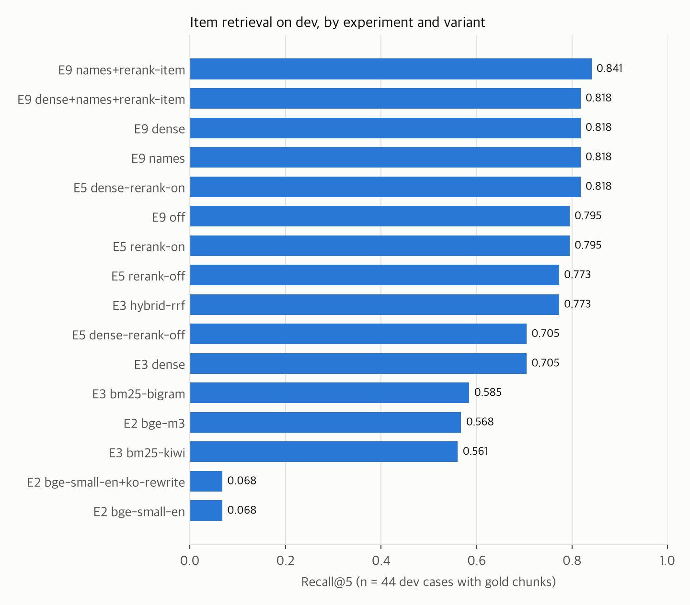
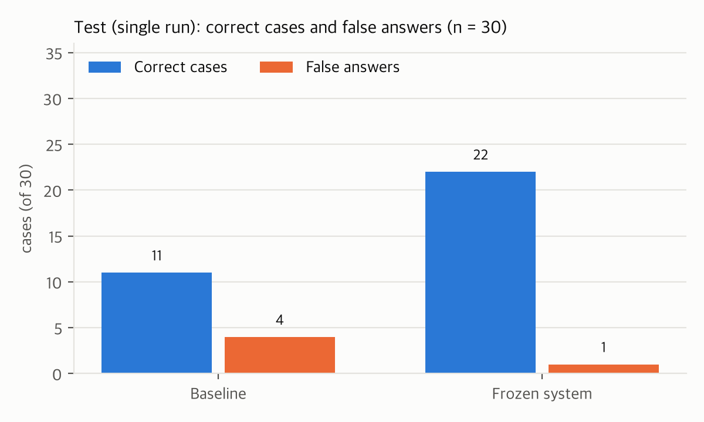
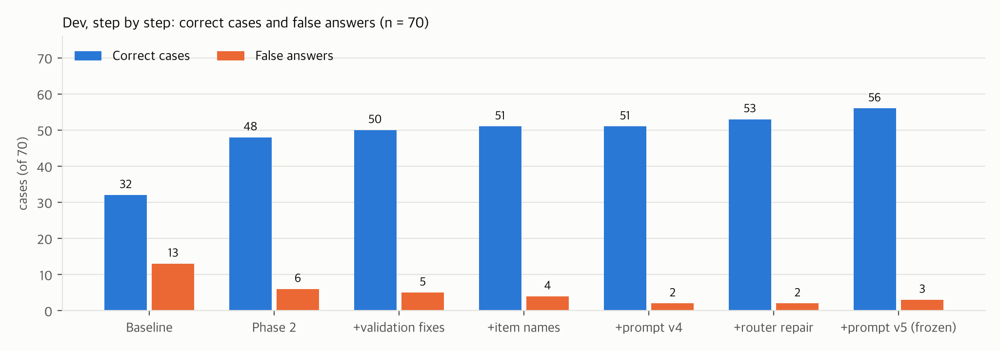
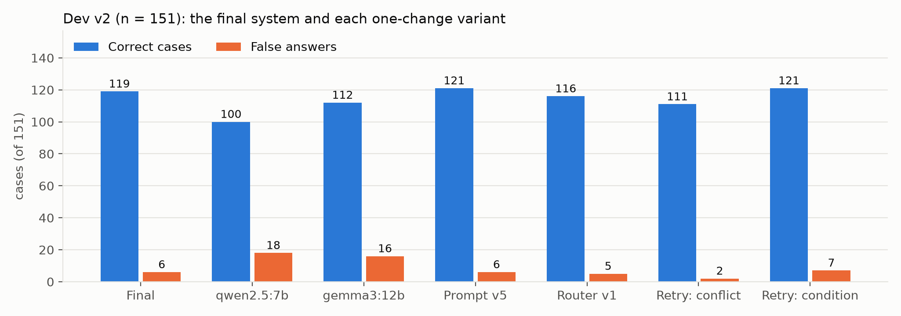
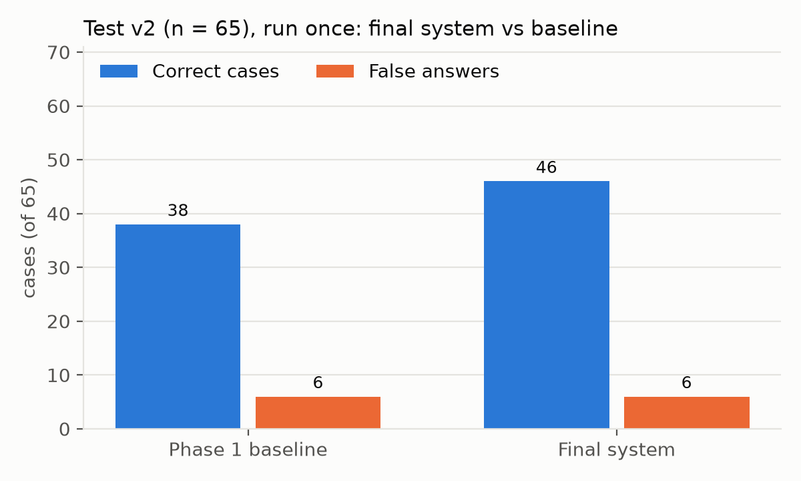
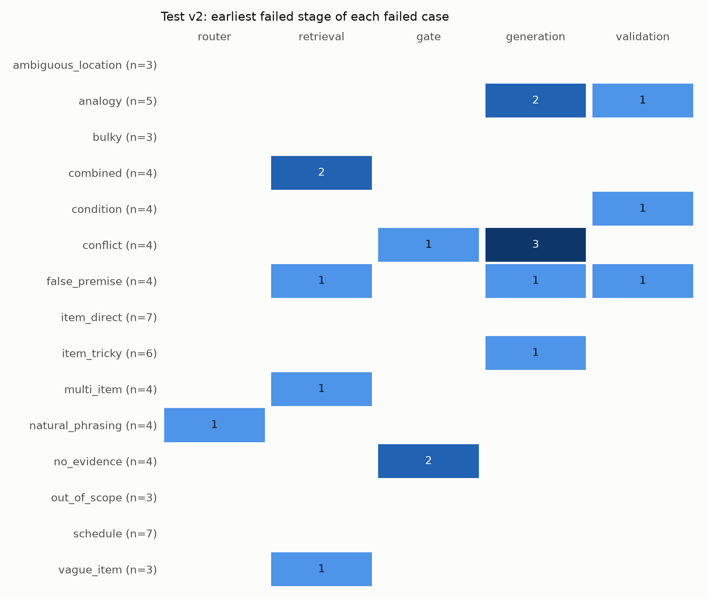
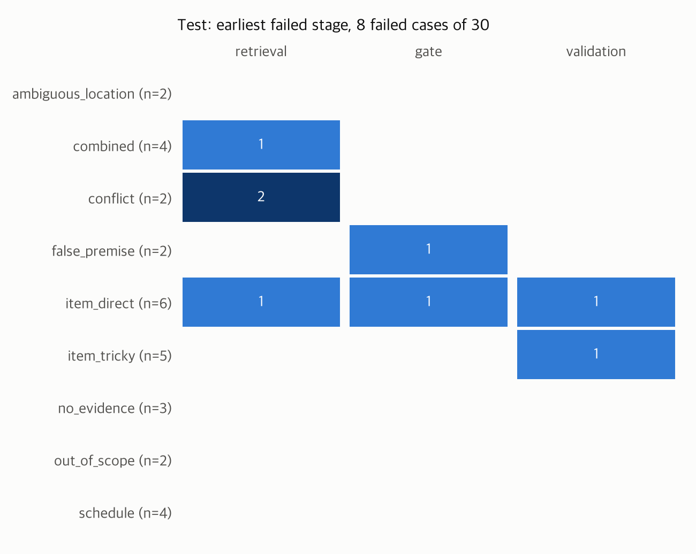

# Waste-Sorting Assistant for Foreigners in Korea

<p class="subtitle">Final report · 202620HY33390 Design of Generative AI Application Systems, Hanyang University · Team (equal contribution): Anar, Naura, Shukurullo, Vitou · 2026-11-08, final system 2026-11-16</p>

> **In one paragraph.** A foreigner in Korea asks, in their own language, which bin an item goes in and when waste is collected in their neighbourhood. The assistant answers from two official sources: the national separation guides for items, and the district collection table for days and places. It cites both, and it answers several items in one question item by item. When it cannot answer safely, it says so and hands off to the district office with a Korean sentence the user can show. The final system (gemma4:12b as router and generator, §8.7) was frozen and run once on 65 held-out test cases: 46 correct with 6 false answers (answering when it should not, or with the wrong bin), against 38 and 6 for the Phase 1 baseline on the same model (§8.8). A first test run of an earlier system on 30 cases is reported in §8.1–8.6: 22 correct with 1 false answer, against 11 and 4 for the baseline. Every question that should have been asked back or refused as out of scope was handled correctly in both runs, and every schedule shown was the right one. The main weaknesses are outdated 2018 entries that outrank newer 2026 rules (the conflict slice), items that look like one material but belong to another (a plastic hanger as 고철), and answers to questions the sources do not cover.

## 1. Problem, users, scope (Lesson 1)

**Users.** International students and other foreign residents who do not read Korean well, mainly in Seoul.

**Questions.** "Which bin does this item go in, and how do I prepare it?" (item questions) and "When and where can I put out food waste in 행당1동?" (schedule questions), or both at once.

**Why it matters.** Mistakes mean trash left uncollected, fines, and friction with neighbours. The official rules are in Korean PDFs and a 10,187-row spreadsheet.

**Non-goals.** Business waste, construction waste, scrapping a car, fines and prices, and anything outside household waste in Korea. These are refused (`OUT_OF_SCOPE`) or handed off.

**Cost of errors.** A confident wrong bin costs the user more than an abstention. So the system is built to abstain when its evidence is weak, and the main safety number is the **false-answer rate**.

## 2. Data sources and their quality (§3)

| Source | Used for | Size | Notes |
|---|---|---|---|
| Ministry of Environment, *Recycling Separation Guideline* (2018), 36 pages | Item bins, FAQ, general rules | 293 items, 36 FAQ, 20 guide pages | Food-waste tables on p.17–18 lost their layout in PDF extraction: 9 rows transcribed by hand |
| Separation directive, Annex 1 (effective 2026-01-01) | Current rules by material group | 42 rules, 3 notes | Some items changed since 2018 (clear PET bottles, small electronics) |
| data.go.kr household-waste collection table (CP949) | Days, times, places, method, office phone | 10,187 rows, 222 districts | 61% of rows are over a year old; Seoul 강동구 and 도봉구 have no rows; 7 district names exist in several provinces |

The data work was done before any tuning, following the lesson "do not measure on known-bad data". It included:
- stable UUIDv5 chunk IDs;
- splitting area lists such as `휘경1,2동`;
- keeping the province, so the seven duplicated district names (such as 중구) can be told apart;
- a romanised-to-Korean alias table (1,723 aliases);
- flagging stale rows.

Details: `data/reports/data_quality.md`, `docs/PHASE2_NOTES.md` §1.

## 3. Ingestion contract and index verification (Lesson 3)

The 403 item chunks (`data/processed/item_chunks.jsonl`) are embedded with **BAAI/bge-m3**, pinned by revision, into a local Qdrant collection. The collection's name includes the model revision and the corpus hash (`items_bge-m3_5617a9f6_c7d19676`). The pipeline refuses to run if the corpus hash does not match, so old and new chunks are never mixed. Each build is verified before it is published: point count, no duplicate IDs, and a test that every chunk retrieves itself (`ingest/verify_index.py`).

Schedules are **not** embedded for answering. The rows are near-duplicates that differ only in the district name, so vector search returns the wrong district (E4, §8).

## 4. Representation and embedding choice (Lesson 2, E2)

The corpus is Korean, while questions come in six languages. **E2** (dense retrieval only, the original question as the query, n = 44 dev cases with gold chunks):

| Embedding | Recall@5 | MRR |
|---|---|---|
| bge-small-en (course default, English only) | 0.068 | 0.064 |
| bge-small-en, query rewritten into Korean | 0.068 | 0.069 |
| **bge-m3 (multilingual)** | **0.568** | **0.474** |

An English-only model cannot represent Korean chunks at all, even when the query itself is Korean. bge-m3 is the only usable option.

## 5. Retrieval design (Lessons 4–5)

```
question ─► router (LLM, JSON): intent, items (each with a Korean name + query), district/dong, waste type, day
         ─► item retrieval: dense (bge-m3) + BM25 (kiwi) for the question and its Korean rewrite,
            + item-name search (router's item name vs chunk names)  ─► RRF (k = 60) ─► top 20
            ─► cross-encoder rerank (bge-reranker-v2-m3, best score over all queries) ─► top 5
         ─► schedule tool: typed lookup over the table (province, district, area), dates computed in code
         ─► gate: answer / abstain (top rerank score < τ) / ask back (ambiguous place) / out of scope
```

**Router.** The router extracts each item asked about (router v2: one entry per item, each searched on its own, the lists then taken in turn) with a Korean name and rewrite. The district and neighbourhood are first read by code from the table's own names (the place reader, §8.7); the router's guess is the fallback. Its output is checked against the question: the item must appear in it, the rewrite must be Hangul, a negation must be kept, and a place must be one the question mentions. A rewrite that fails these checks is not used.

**Retrieval experiments on dev** (Recall@5 / MRR, n = 44):

| Experiment | Variant | Recall@5 | MRR |
|---|---|---|---|
| E3 | dense | 0.705 | 0.600 |
| E3 | BM25 (kiwi morphemes) | 0.561 | 0.433 |
| E3 | BM25 (character bigrams) | 0.585 | 0.494 |
| E3 | hybrid (RRF) | 0.773 | 0.583 |
| E5 | hybrid + rerank | 0.795 | 0.678 |
| E5 | dense + rerank | 0.818 | 0.693 |
| **E9** | **hybrid + rerank + item names** | **0.841** | **0.730** |
| E9 | dense + rerank + item names | 0.818 | 0.713 |



- **Hybrid beats dense before reranking** (E3: three cases better, none worse). BM25 alone is weak on English and Uzbek questions.
- **The reranker adds 0.02–0.11 Recall@5.** With the reranker, dense alone is about as good as hybrid: 0.818 vs 0.795, one case apart.
- **E9, item-name search, was added in Stage 3.** It came from the dev failure analysis: 9 of the 22 failed cases had a wrong or unusable Korean rewrite, such as 퍼플라이트 for a fluorescent tube or 참외 (Korean melon) for pineapple. The router's item name is matched against each chunk's short item name, not the whole chunk. For example, "pineapple peels" then finds 파인애플껍질 and "batteries" finds 전지. Together with reranking on the item name, Recall@5 rose from 0.795 to 0.841 with no case worse. With dense instead of hybrid it was 0.818 and one case worse, so BM25 stays.
- **These differences are 1–2 cases out of 44.** They are not statistically separable, and we do not claim they are. We chose by "no case worse" plus the full-system result (§8).

**Gate threshold (E5 τ sweep).** The gate abstains when the best rerank score among the 5 evidence chunks is below τ. On dev, every τ from 0.03 to 0.65 gives zero false positives. Only 2 item cases that should be refused reach the gate (0.029 and 0.032); the Phase 2 probes add one more at 0.039. We **kept τ = 0.15**. A τ just above 0.039 would answer 3 more cases (h31 at 0.051, item14 at 0.068, h23 at 0.084), but h23 would be answered from the wrong evidence (glass-bottle chunks for a PET-bottle question). A threshold 0.01 above the highest negative seen is not trustworthy with three negatives. This is a judgement call, and it is recorded here.

**Schedule lookup (E4).** These are the 23 dev cases that need a schedule or a place: the schedule, combined and ambiguous_location slices.

| Variant | Correct | Gold row shown | Only gold rows | Another district's rows | Asked back when ambiguous |
|---|---|---|---|---|---|
| **Structured lookup** (province, district, area; code) | **23/23** | **19/19** | **18/19** | **0** | **4/4** |
| Vector search over the rows | 18/23 | 18/19 | 0/19 | 8 | 0/4 |
| Vector, then filter by district | 19/23 | 19/19 | 2/19 | 0 | 0/4 |
| Filter by district, then vector | 19/23 | 19/19 | 2/19 | 0 | 0/4 |

The rows of different districts are near-duplicates, so plain vector search showed another district's days in 8 of 19 cases. Filtering fixes the place, but it still shows the neighbouring zones of the district (only gold rows: 2/19). No vector variant can ask back for a district name that is used in several provinces, because it always returns some rows. The structured lookup was kept.

## 6. Generation contract, validation and handoff (Lessons 1, 4, 7)

**Generator.** gemma4:12b through Ollama in the final system (qwen2.5:7b in the v1 system that §8.1–8.6 describe; E10 in §8.7), with temperature 0 and seed 7, thinking turned off. The router uses the same model. Output is constrained to a JSON schema: status, answer_text with `[n]` citations, citations, missing, and one record per item asked about (item, bin, how_to_prepare, citations; prompt v6). The v1 system used prompt v5, with a single bin and how_to_prepare. The context is built under a token budget (8,192-token context, 768 reserved for the answer). The generator sees **item evidence only**: days, times and places are written by code from the table, in the user's language. In Phase 2 the LLM dropped and invented days in 7 of 19 schedule answers, and writing them in code fixed that. The LLM only translates the free-text method line, with its own prompt.

**Prompt versions (E1).** Only the prompt changes between these variants; retrieval, gate and validation stay the same (dev, n = 70, router repair off):

| Prompt | What it adds | Correct | False answers | Bin | Unsupported 종량제봉투 |
|---|---|---|---|---|---|
| v0 | minimal instruction | 32 | 2 | 8/45 | 4 |
| v1 | zero-shot contract (rules + JSON schema) | 48 | 4 | 24/45 | 3 |
| v2 | + three worked examples | 51 | 4 | 27/45 | 5 |
| v3 | + "no steps from the examples" | 49 | 5 | 25/45 | 7 |
| v4 | + a rule for wrong premises; schedule example replaced | 51 | 2 | 27/45 | 8 |
| **v5** | **v4 with the example bins balanced** | **54** | **3** | **30/45** | **2** |

- **The contract does most of the work.** v0 → v1 is +16 cases. Without the contract, v0 seldom names a bin (8/45). Its 2 false answers are low only because it rarely answers.
- **The examples leak their bins.** "Unsupported 종량제봉투" counts the answers that named the general waste bag although the case does not accept it. In v4 all three examples show 종량제봉투: the pen, the cushion of the false-premise example, and both distractors of the abstention example. The model then said 종량제봉투 against its evidence in 8 cases: metal cans, bubble wrap and spoiled food among them. v5 changes only the examples: the false-premise example became a metal kettle that goes with scrap metal (고철), and one distractor became iron tools (고철). Unsupported 종량제봉투 bins fell to 2, and v5 is worse than v2 on no case and better on three (h03, h37, h73). Validation had caught most of the v4 cases, as abstentions, so the gain is mostly in correct answers, not in false answers.
- **Every example item was checked against all 100 cases** (Korean, English, Russian, Chinese, Vietnamese and Uzbek words), so no case can be answered by copying an example.
- **Caveat.** v5 is the best of six prompts on the same 70 dev cases, so its dev score is optimistic. The test split (§8) is the check.

**Conflict policy (E8).** By default the prompt tells the model that when the 2018 guide and the 2026 rules disagree, the 2026 rule applies. Without that sentence, dev was 57/70 correct with 4 false answers, against 56/70 and 3 with it: one case each way, which is noise. We kept the rule because it states the actual legal order. Neither variant solves the **conflict slice** (0/6 and 1/6 on dev). In these cases both years are retrieved, and the 7B model still answers with the 2018 bin, or with general waste, as for the thermometer (h26). This is the weakest slice: see §9.

**Router repair.** When the Korean rewrite fails its script check (for example `기름occo散布的纸张`), the router is asked once more, with the reason. On dev this rescued two Uzbek cases (h08, item14) and made none worse, so it is on.

**Validation (enforce mode).** Any failed check turns an `ANSWER` into `INSUFFICIENT_CONTEXT` with a handoff. The checks are:
- **The bin is a known category** (18 canonical bins and their aliases, `rag/bins.py`).
- **The cited chunks state that bin.** These are their 2018 categories or their 2026 rule group; for chunks that state no bin, it is a text match.
- **The bin field agrees with the bins named in the text.**
- **Several items: each item's bin is stated by that item's own cited chunks** (prompt v6), and one failed item withholds the whole answer.
- **The answer cites at least one chunk.**
- **No invented days or times.** An answer must not state days or clock times that its sources do not contain. Stage 3 extended this from schedule answers to item-only answers, after dev item10 copied "Tue, Thu, Sat 19:00–23:00" from a few-shot example into an answer about spoiled food.

**Retry of withheld answers** (final system, E12). An answer that validation would withhold is asked once more, with the reason and the bins its cited evidence states; the new answer is kept only if it passes every check.

Stage 3 also fixed two gaps in the bin checks. A 2026 sub-item that is itself a bin now decides: 종이팩 under 골판지 외 종이류. And an empty bin field is filled from Korean bin names in the text, such as 폐가전제품.

**Answer contract.** Every answer fits a typed contract (`rag/contract.py`, schema in `docs/answer_schema.json`) with rules between fields. For example, `CLARIFY` needs a question, and an abstention needs a handoff. All 49 Stage 1 probes and every evaluation answer satisfied it: **0 contract problems in 550 evaluation answers** (the 7 dev runs and the 2 test runs of the v1 cases in `eval/reports/`), and 0 in the final system's dev v2 run and both test v2 runs.

**Handoff (Lesson 7, Klarna).** An abstention gives the user:
- the district office and its phone number;
- a Korean sentence to show the staff, written by code, never by the LLM;
- what the assistant checked.

The fixed texts are written in six languages (`rag/texts.py`). The zh, vi, uz and ru drafts have not been checked by a native speaker.

## 7. Evaluation method (Lesson 6)

**Cases.** There are 100 cases in 9 slices (`eval/cases/`, schema in `eval/cases.py`):
- 65 hand-written cases (tricky items, 2018/2026 conflicts, false premises, no evidence, ambiguous places, out of scope, combined item + schedule);
- 20 item cases from templates over the item dictionary;
- 15 schedule cases from templates over the table, one per district.

Gold chunk IDs and gold schedule rows come from scans of the data (`eval/label_helper.py`), never from the system's own output.

**Split.** The split is 70 dev / 30 test, stratified by slice, with seed 20261108. Its SHA-256 hashes were frozen in `split_manifest.json` (commit `19f079d`) **before any tuning**. Twelve cases already seen during development were forced into dev. All tuning (E1–E9, τ, the Stage 3 fixes) used dev only. The test split was run **once**, with the configuration frozen at commit `f0faba6` (§8). A test report lists no per-case rows, so nobody could tune on it.

| Slice | Dev | Test | Expected behaviour |
|---|---|---|---|
| item_direct | 14 | 6 | answer |
| item_tricky | 11 | 5 | answer |
| conflict (2018 vs 2026) | 6 | 2 | answer with the 2026 rule |
| false_premise | 6 | 2 | answer, correcting the premise |
| combined (item + schedule) | 8 | 4 | answer both |
| schedule | 11 | 4 | answer |
| no_evidence | 7 | 3 | abstain |
| ambiguous_location | 4 | 2 | ask back |
| out_of_scope | 3 | 2 | refuse |
| real_users | 0 | 0 | **missing**: no real student questions were collected |

Languages: dev has en 25, ko 22, uz 7, zh 6, ru 6 and vi 4. Test has en 15, ko 8, vi 3, ru 2 and zh 2, and **no Uzbek case**, so Uzbek is measured on dev only.

**Case set v2 (final system).** After the first test run the cases were rebuilt as `eval/cases/v2/`: 216 cases (188 hand-written, 28 from templates) in 15 slices, split 151 dev / 65 test with seed 20261108, stratified by slice, and frozen with SHA-256 hashes before any tuning (`eval/cases/v2/split_manifest.json`). 47 cases already seen during development were forced into dev. The new slices are several items (multi_item), vague items, analogies, conditions (dirty, broken, coated), bulky waste and natural phrasing.

| Split | Cases | answer / abstain / clarify / out of scope | en | ko | zh | vi | ru | uz |
|---|---|---|---|---|---|---|---|---|
| Dev v2 | 151 | 120 / 16 / 7 / 8 | 33 | 30 | 26 | 24 | 22 | 16 |
| Test v2 | 65 | 52 / 7 / 3 / 3 | 21 | 13 | 7 | 8 | 5 | 11 |

**Metrics** (`eval/metrics.py`; undefined values are counted, not hidden):
- **Case correct.** For answer cases: `ANSWER`, the bin in the expected set, and a gold row shown where a schedule is expected. For the others: the expected behaviour.
- **False answer.** `ANSWER` when the case should not be answered, or `ANSWER` with a bin outside the expected set. This is the costly error.
- **Item withheld.** For a combined question, the item part can be refused while the schedule is still answered, with a sentence saying the item could not be confirmed. That is not correct, but it names no wrong bin, so it is counted on its own and not as a false answer. Until Stage 3 the code counted it as a false answer, contrary to the definition above. This was fixed before the test run, and every dev report was scored again from its saved traces (`python -m eval.run_eval --name <report> --rescore`). The baseline went from 21 to 13 false answers on dev, 8 of them withheld items.
- **Every bin named** (several-item and vague-item cases): every expected bin appears in the answer.
- **Retrieval:** Recall@5, MRR, nDCG@5 and P@5 on the reranked order.
- **Gate:** TP/FP/FN/TN. **Schedule:** gold row found, and only gold rows shown.
- **Citations:** whether a gold chunk is cited, and citation precision.
- **Language:** whether the answer is in the asked language's script.
- **Latency per stage.**
- **Failure stage:** for every failed case, the earliest stage that went wrong, labelled by rule from its trace.

**LLM judge.** Ragas 0.4.3 measured faithfulness and context relevance, with **exaone3.5:7.8b** (LG AI Research, digest `c7c4e3d1ca22`) as the judge. The judge comes from a different model family than the generator, so the system does not grade its own answers. It still is a 7.8B model, so its scores need a human check (§8.3, §11).

**Statistics.** With 30 (v1) or 65 (v2) test cases, every rate is shown as a count ("26/30"), and each headline rate also gets a 95% Wilson interval (`eval/stats.py`). Wilson stays valid for small n and for 0/n or n/n, where the normal approximation does not. The system and the baseline ran on the same cases, so they are compared as pairs: the exact McNemar test looks only at the cases where exactly one of the two is right (`python -m eval.compare test-v2-final test-v2-baseline`; no models are needed). One case is 3.3 points on v1 test and 1.5 on v2 test, so differences of one or two cases are noise. The template cases are not independent of each other, so even the intervals are somewhat optimistic.

## 8. Results (Lesson 5)

The project was tested twice, each time once, on a split frozen before tuning. §8.1–8.6 report the first system (qwen2.5:7b, prompt v5, router v1) on the v1 cases. §8.7–8.8 report the final system (gemma4:12b, prompt v6, router v2, place reader, retry), tuned on dev v2 and run once on test v2.

### 8.1 The first test split (v1 cases): one run of the system frozen at `f0faba6`

The configuration was frozen at commit `f0faba6` (`rag/config.py`): hybrid retrieval with item-name search, the reranker on all queries, τ = 0.15, router repair, prompt v5, the 2026 conflict rule, validation in enforce mode, and the structured schedule lookup. Test was then run once, with no reply cache. The only file changed during the run was this report, which the pipeline does not read. Every run record up to 2026-11-11, this one included, says `git_dirty: true` ("uncommitted changes"). That flag was wrong: the check counted the run's own output folder (`eval/reports/<name>/`), which the run writes before the check. The check now leaves out run output (`eval/provenance.py`), and later records also store the Ollama digest of the generator and router. The old records were left as recorded. Run records (`report.json`, `manifest.json`) store commit IDs from before 2026-11-09, when commit messages were edited; [COMMIT_IDS.md](COMMIT_IDS.md) maps them to the current IDs (file contents unchanged). The **baseline** is the Phase 1 system on the same 30 cases: dense bge-m3 retrieval of the original question, no router, no reranker, no gate, no validation, and prompt v1.



| Metric (test, n = 30) | Baseline | **Frozen system** |
|---|---|---|
| Case correct | 11/30 | **22/30** |
| **False answers** (the costly error) | 4/30 | **1/30** |
| Item withheld (schedule only, not a false answer) | 5 | 1 |
| Bin correct (answerable item cases) | 5/19 | 11/19 |
| Abstained when it should | 3/5 | 5/5 |
| Asked back for an ambiguous place | 0/2 | 2/2 |
| Gold schedule row shown / only gold rows | 7/8 / 7/8 | 8/8 / 8/8 |
| Retrieval Recall@5 / MRR (n = 19) | 0.526 / 0.393 | 0.684 / 0.470 |
| Gate TP / FP / FN / TN | no gate | 15 / 1 / 4 / 2 |
| Cites a gold chunk / citation precision | 8/13 / 0.58 | 7/12 / 0.58 |
| Answer in the asked language | 18/18 | 13/13 |
| Contract problems | 0 | 0 |
| Latency, median (s) | 9.4 | 21.7 |

By slice and language, frozen system on test (correct / cases):

| Slice | Test | Dev (same config) | | Language | Test | Dev |
|---|---|---|---|---|---|---|
| item_direct | 3/6 | 9/14 | | en | 10/15 | 18/25 |
| item_tricky | 4/5 | 11/11 | | ko | 7/8 | 21/22 |
| conflict | **0/2** | **0/6** | | ru | 2/2 | 5/6 |
| false_premise | 1/2 | 4/6 | | zh | 2/2 | 5/6 |
| combined | 3/4 | 8/8 | | vi | 1/3 | 2/4 |
| schedule | 4/4 | 11/11 | | uz | – | 5/7 |
| no_evidence | 3/3 | 6/7 | | | | |
| ambiguous_location | 2/2 | 4/4 | | | | |
| out_of_scope | 2/2 | 3/3 | | **All** | **22/30** | **56/70** |

- **Test is lower than dev: 73% against 80%.** That is the expected price of tuning six prompts and several retrieval options on dev. The gap is mostly in the item slices, where retrieval on test is also lower (Recall@5 0.684 against 0.841). Only 19 test cases have gold chunks, so one case is 5 points.
- **The accuracy gain is real; the safety gain is not yet shown on test.** Paired test against the baseline on the same 30 cases (95% Wilson intervals, exact McNemar test):

  | Metric (test) | Frozen system | Baseline | Only system right | Only baseline right | p |
  |---|---|---|---|---|---|
  | Case correct | 22/30 (56–86%) | 11/30 (22–54%) | 13 | 2 | **0.007** |
  | Bin correct | 11/19 (36–77%) | 5/19 (12–49%) | 8 | 2 | 0.11 |
  | False answers (fewer is better) | 1/30 (1–17%) | 4/30 (5–30%) | – | 3 cases only the baseline got wrong | 0.25 |

  The case-correct gain is significant. The drop from 4 to 1 false answers is in the right direction but, with 30 cases, it could be chance (p = 0.25), and the true false-answer rate can be anywhere from about 1% to 17%. On dev the same drop is larger and significant (13 → 3 of 70, p = 0.006), but dev was used for tuning, so that does not count as held-out evidence. Every case that should be refused or asked back was handled: no_evidence 3/3, out_of_scope 2/2, ambiguous_location 2/2. All 8 schedule rows were right, and no other district's rows were shown.
- **The weakest slice is the 2018-vs-2026 conflict** (0/2 test, 0/6 dev): see §9.2.
- **The baseline is fast because it does less.** It has no router (7 s) and no reranker (6 s). Its "item withheld" count of 5 shows how often its answers covered only part of a combined question.

### 8.2 Dev (v1 cases), one change at a time



| Step (dev, n = 70) | Correct | False answers | Bin | Recall@5 |
|---|---|---|---|---|
| Baseline (Phase 1) | 32 | 13 | 17/45 | 0.556 |
| Phase 2 full system | 48 | 6 | 24/45 | 0.795 |
| + validation fixes (rule sub-items, bins named in the text, invented days in item answers) | 50 | 5 | 26/45 | 0.795 |
| + item-name search, reranking on the item name (E9) | 51 | 4 | 27/45 | 0.841 |
| + prompt v4 (wrong-premise rule) | 51 | 2 | 27/45 | 0.841 |
| + router repair | 53 | 2 | 29/45 | 0.841 |
| **+ prompt v5 (balanced examples) = frozen** | **56** | **3** | **32/45** | **0.841** |

Each Stage 3 step was measured on the full dev split. None made more than two cases worse, and the last two made none worse; the cases are listed in each experiment's `summary.md`. These runs replayed identical model requests from a reply cache (`--cache`), so their latencies are not valid. Only the uncached runs give latency: the Phase 2 system on dev and the test run.

### 8.3 Faithfulness with an LLM judge (Ragas; first system)

The judge is exaone3.5:7.8b, a different model family from the generator. Of the 22 test answers, 17 had item or schedule evidence to judge.

| Test answers (n = 17) | Faithfulness | Context relevance |
|---|---|---|
| All | 0.854 | 0.868 |
| schedule (4) | 0.938 | 1.000 |
| combined (4) | 0.875 | 0.875 |
| item_tricky (4) | 0.900 | 0.875 |
| item_direct (3) | 0.667 | 0.750 |

- **Faithfulness is not correctness.** The one false answer (h25, electric toothbrush → general waste bag) scores faithfulness 1.0: it is faithful to the 2018 chunk it cites, which the 2026 rule overrides. The judge cannot see a rule that was never retrieved.
- **The low scores are of two kinds.** Some answers add steps from evidence about another item. h15, a broken mug (0.6), takes "wrap it in newspaper; buy a special bag for large amounts" from the broken-glass FAQ. h76, old books (0.67), paraphrases the paper rules beyond what they say. Others are **judge errors**: item05 (mop → 대형) and item15 (desk calendar → 종이) state exactly the bin of the chunk they cite, yet they score 0.5. We read the five lowest-scoring answers by hand to find this. A 7.8B judge on 17 answers is noisy, which is why the human audit is part of the plan.
- **These scores are unchecked by people.** The audit sheets for two raters (17 answers, `eval/reports/test-final/audit/`) are exported but not filled in yet. Until they are, the judge's agreement with humans is unknown (§11).

### 8.4 Robustness probes (first system; test, 19 answer cases with gold chunks)

The probes change the evidence after retrieval and before the gate (`experiments/robustness.py`, RGB-style):

| Probe | What changes | Outcome |
|---|---|---|
| clean | nothing | right bin 11, abstained 7, wrong bin 1 |
| noise | 3 chunks about other items, with other bins, appended | same bin 11, abstained as in clean 6, 1 abstained that clean answered, 1 answered that clean refused; **no bin changed** |
| negative | every gold chunk removed; the next candidates move up | abstained 9, right bin anyway 6 (from an FAQ, a guide page or a similar item), **wrong bin 4** |
| counterfactual | a false chunk at rank 1, written like a 2018 entry for the asked item, with a wrong bin | **followed it 12**, abstained 4, right bin 3 |

- **Noise does not hurt.**
- **Missing evidence is mostly refused**: 9 of 19 abstained, and 6 more found the bin elsewhere. In 4 the model took the wrong bin from what was left: a similar item (machine oil for cooking oil), a general guide page (umbrella, shells), or the outdated 2018 entry (electric toothbrush, as in the clean run).
- **A false chunk that names the item is believed** in 12 of 19 cases. Validation checks that the cited chunk states the bin, so it passes a bin that a planted chunk states. This is the main threat if a wrong entry ever reaches the corpus. It also argues for keeping the corpus manifest and hashes (§10), and for future work 3 (§11).

### 8.5 Stability across sampling (first system; E7, dev, 20 cases × 3 temperatures × 5 seeds)

| Temperature | Same status and bin under all 5 seeds | Abstention flips | Correct (range over seeds) | False answers (range) |
|---|---|---|---|---|
| **0.0** (used) | **20/20** | 0/20 | 12 | 1 |
| 0.7 | 8/20 | 11/20 | 6–11 | 1–4 |
| 1.0 | 6/20 | 12/20 | 8–9 | 2–6 |

At temperature 0 with a fixed seed the answer is reproducible: the same question gets the same answer. Sampling makes the system both less correct and less safe. The 20 cases are the first 20 of dev (item_tricky, conflict, false_premise), which are harder than average.

### 8.6 Latency (first system)

The median is 21.7 s per question on an Apple M3 Pro (36 GB) with local models (test run, no cache). The stages are the router 6.6 s, the reranker 5.9 s, the generator 13.8 s, and the schedule text 1.3 s (only when there is a schedule). The reranker is slower than in Phase 2 (3.4 s) because it now scores the item names as extra queries.

**v2.1: the same answers, a faster reranker.** After the test run, the reranker was changed to score all distinct query–chunk pairs in one model call, sorted by length (it had made one call per query, and scored a repeated query twice). The models are also kept loaded between questions, and the website loads them at start. The change was accepted only after two checks on dev (no test cases were used):
- **Retrieval.** On the 46 dev cases that reach the reranker, the candidate order and scores are identical to the frozen system's saved traces (maximum difference 0.0). The median rerank time falls from 6.56 s to 2.67 s, measured in one process on the same cases (`python -m experiments.verify_rerank`, `experiments/results/dev/perf/rerank_batching.json`).
- **Whole system.** An uncached run on all 70 dev cases (`eval/reports/dev-v2.1`, clean tree, generator digest recorded) gives the same status, bin, citations and answer text in **70/70** cases as `dev-s3e-final`. It scores the same: 56/70 correct, 3 false answers.

| Stage, median (s) | Test run (v2) | Dev run (v2.1) |
|---|---|---|
| Router | 6.6 | 6.8 |
| Reranker | 5.9 | **2.8** |
| Generator | 13.8 | 13.1 |
| Total, item questions | – | 23.1 |
| Total, all questions | 21.7 | 21.2 |

The two splits have different cases, so only the reranker row is a controlled comparison. The test numbers in §8.1 stay valid for v2.1, because no answer changed. About 87% of the remaining time is the two LLM calls (router about 7 s, generator about 13 s). The generator's full prompt, about 2,600 tokens, is evaluated on every call (`prompt_eval_count` ≈ the counted prompt). The router and the generator take turns on one model, so neither keeps its cached prompt prefix. Giving Ollama two parallel slots (`OLLAMA_NUM_PARALLEL=2`) could keep both cached. It counts only if a dev run then gives the same answers, and it has not been tried yet. Skipping the router for questions whose place comes from the dropdowns would change answers, so it belongs to v3.

### 8.7 The final system: one change at a time on the v2 dev set

After the first test run the case set was rebuilt as `eval/cases/v2/` (216 cases: 151 dev, 65 test), with new slices (several items, vague items, analogies, conditions) and the Lesson 6 metric definitions (true Recall@5, Hit@5, claim-level citation precision and coverage). The split was frozen before any tuning (`eval/cases/v2/split_manifest.json`, seed and SHA-256). Every decision below was made on dev v2 only, by changing one setting of the final default at a time (`experiments/results/dev_v2/<id>/summary.md`, exact McNemar test on the paired cases).



| Experiment (dev v2, n = 151) | Variant: the only change | Correct | False answers | Every bin named (n = 18) | Paired test | Kept |
|---|---|---|---|---|---|---|
| **Final default** | gemma4:12b, prompt v6, router v2, retry `rejected` | **119** | **6** | **10** | – | – |
| E10 model | qwen2.5:7b | 100 | 18 | 6 | correct p = .002, false p = .008 | gemma4:12b |
| E10 model | gemma3:12b | 112 | 16 | – | – | gemma4:12b |
| E1 answer prompt | v5 (one bin) | 121 | 6 | 11 | p = .73 / 1.0 | v6 |
| E11 router | v1 (one item, one search) | 116 | 5 | 9 | p = .45 / 1.0 | v2 |
| E12 retry | `conflict` (bin/text conflicts only) | 111 | 2 | 9 | correct p = .02, false p = .22 | `rejected` |
| E12 retry | `condition` (exception lines count) | 121 | 7 | – | – | `rejected` |

- **E10, the LLM.** The router and the generator share one local model (16 GB GPU). gemma4:12b answered 19 more cases than qwen2.5:7b with 12 fewer false answers, both significant. Its Korean rewrites are cleaner (Recall@5 0.658 → 0.783). Median latency is 7.7 s (qwen 6.8 s), p90 12.1 s. Thinking is turned off (`"think": false`). Gemma's tokenizer is licence-gated, so its prompts are counted with the Qwen tokenizer, which counts about 4% high and never low.
- **E1 and E11, several items.** Both tie on accuracy, so both are kept for what they add. Router v2 searches each item on its own (Recall@5 0.754 → 0.783), and prompt v6 gives each item its own bin, steps and citations, each validated against that item's own evidence. With v5 the other bins are only named in the text, unchecked, and the website shows one bin card.
- **E12, the retry.** An answer that validation would withhold is asked once more, with the reason. It fixes 9 cases and breaks 1, but adds 4 false answers. In two of them (k08, p06: Styrofoam with food on it) the cited 2026 rule sends soiled Styrofoam to 종량제봉투 in an exception line, and the retry copied the rule's heading bin instead. The `condition` variant accepts a bin named in such an exception line and asks the retry to keep the question's condition. It fixed k08 and p06, but the same acceptance let in "broken glass → 종량제봉투" for a broken ceramic pot and heat-resistant glass (d05, t10), so it was not kept. `rejected` was kept for its correct answers. The false-answer difference is not significant at this size.
- **Place reader** (`rag/places.py`). The district and neighbourhood are read by code from the district table's own names, in Korean, Revised Romanization and Kontsevich Cyrillic ("Guro-gu", "Пучхон", "부천 송내1동"), before the router's guess. On dev v2, districts read right went from 10 to 16 of 19, and the gold schedule row shown from 19 to 25 of 28. Chinese-character names (富平区) are not covered.
- **Website.** Answers follow contract 2.0 (`items` with per-item steps, `put_out_steps`). Sources open the cited page of the official PDF in a pop-up. An item question with an area chosen also shows that area's collection days for the answered bin (종이 → recycling days); an area read from the question does not.

### 8.8 The v2 test split: one run of the final system

The configuration was frozen at commit `ccb3966` and run once on the 65 v2 test cases (`eval/reports/test-v2-final`). The baseline is the Phase 1 system (dense retrieval of the original question, no router, reranker, gate or validation, prompt v1) on the same cases and the same model, gemma4:12b (`eval/reports/test-v2-baseline`).



| Metric (test v2, n = 65) | Baseline | **Final system** | Paired test |
|---|---|---|---|
| Case correct | 38 (58%, 46–70%) | **46 (71%, 59–80%)** | 16 vs 8 discordant, p = .15 |
| Expected behaviour | 46 | **51** | p = .38 |
| Bin correct (n = 44) | 28 | 27 | p = 1.0 |
| False answers | 6 (9%) | 6 (9%, 4–19%) | p = 1.0 |
| Recall@5 (n = 44) | 0.413 | **0.689** | – |
| Every expected bin named (n = 8) | 3 | **6** | – |
| Median latency | 4.0 s | 8.1 s (p90 11.7 s) | – |

- **The gain in correct cases does not reach significance with 65 cases** (p = .15). It comes from what the baseline lacks: asking back for an ambiguous place (3/3 vs 0/3), refusing out-of-scope questions (3/3 vs 0/3), direct item questions (7/7 vs 4/7) and several items (3/4 vs 1/4). The baseline is better where it should refuse: it abstained on all 4 no-evidence questions, the final system on 2.
- **Bins are no better than the baseline's** (27 vs 28 of 44), although retrieval is much better (Recall@5 0.689 vs 0.413). The final system withholds 6 answers in validation that the baseline, with no validation, answers.
- **Test is lower than dev** (71% vs 79% correct, 9% vs 4% false). The dev score is optimistic: it is the best of the variants tried on the same 151 cases.
- **The 6 false answers.** Two are no-evidence questions answered with 종량제봉투 (old glasses n10, used cat litter n12), which is plausibly right but is not in the sources. Two are "metal" items filed as 고철 (a plastic hanger t12, an electric kettle f06, which is 가전제품). In a several-item answer, rotten vegetables went to 종량제봉투 instead of 음식물 (m01). Coated paper cups were split into 종이 and 플라스틱 (p07).
- **Still unsolved:** the conflict slice (0/4) and analogies (2/5); §9.1 gives the causes.

## 9. Failure analysis (Lesson 6)

### 9.1 The final system on test v2



The heatmap places each of the 19 failed test cases at the **earliest stage whose check failed**, labelled by rule from its trace (`eval/metrics.py`). Rules see symptoms, so we read every failed case:

| Root cause | Cases (test v2) | Ends as |
|---|---|---|
| **The 2026 rule and the 2018 entry disagree** (conflict slice) | k06 power strip, k11 hair dryer, k13 rechargeable hand warmer: the model said 전용함 (the battery/lamp box) while the cited chunk states 가전제품; k09 socks with holes | Validation or gate refusal |
| **A right bin that the cited chunk does not state** | c03 oily vinyl bag (종량제봉투, stated only in the rule's exception line), f09 car tyres (전문시설), an07 wooden spoon (종량제봉투) | Validation refusal |
| **The model refused although the evidence answers** | an02 potato peel, an04 pomelo peel (rewritten as 귤껍질) | Refusal |
| **The right chunk was not retrieved** | v04 takeaway container, f05 crisp packets, m01 rotten vegetables, b04 plastic lunch box, b08 broken plate | Refusal, item withheld (b04, b08), or **false answer** (m01) |
| **The place was not read** | p10: 九老区 (Guro-gu in Chinese characters), which the place reader does not cover | Refusal |
| **A wrong bin from the model** | t12 plastic hanger → 고철, f06 electric kettle → 고철 | **False answer** |
| **An answer where the sources say nothing** | n10 old glasses, n12 used cat litter → 종량제봉투 (the gate passed them on chunks about similar items) | **False answer** |

- **The router is no longer the main cause.** On the first test run, the router's Korean item name caused 5 of 8 failures (§9.2). With gemma4:12b it causes none of the 19; one failure is a place name.
- **12 of the 19 failures end as a refusal and 2 as a withheld item with the schedule answered.** 5 reach the user as a wrong bin or an unwarranted answer; a sixth false answer (p07, coated paper cups → 종이 and 플라스틱) is in a case whose first bin is right.
- **Validation still refuses right answers** (c03, f09, an07), as on the first test run. c03 is the same pattern as the Styrofoam cases of E12: the right bin is in the rule's exception line.

### 9.2 The first test run (v1 cases, system frozen at `f0faba6`)



The heatmap places each of the 8 failed cases at its earliest failed stage. Each was also read to find the root cause:

| Case (test) | Question | What happened | Root cause | Ends as |
|---|---|---|---|---|
| h25 conflict, ko | 전동칫솔 (electric toothbrush) | The 2018 entry (general waste bag) ranked first at 0.997; the 2026 small-electronics rule was not in the top 20 | Retrieval of the newer rule | **False answer** |
| h27 conflict, en | plastic toy car, no batteries | The model said 플라스틱 (right), but the 2026 plastic-toy rule was not retrieved; the cited 2018 toy chunk states other bins | Retrieval of the newer rule; Korean name `플라스틱 장난감 카ars` | Validation refusal |
| h04 item_tricky, en | broken drinking glass | Korean name `_GLASS_`, repair failed; the model named 불연성종량제 (right) but cited the glass-bottle chunks, not 깨진 유리 at rank 2 | Router name; wrong citation | Validation refusal |
| item04 item_direct, en | baby formula can | The model named 고철 (right) but cited the 2026 금속캔 rule, which states another accepted bin | **Validation too strict** | Validation refusal |
| h36 false_premise, vi | "fluorescent lamp is glass, right?" | Korean name `linky bulb`, repair failed; the gold chunk ranked first but scored 0.004 | Router name | Gate refusal |
| item07 item_direct, en | cracked ttukbaegi | Korean query with a Chinese character (`璺은 토기`); gold at rank 4, score 0.008 | Router name | Gate refusal |
| item12 item_direct, en | old scarf | Korean name `구loth`; gold not retrieved | Router name | Gate refusal |
| h78 combined, vi | styrofoam box from electronics | "Hộp xốp" (styrofoam box) translated as "box for electronic items" | Router translation | Item withheld, schedule right |

- **The router's Korean item name is the root cause in 5 of 8**, and it is involved in a sixth (h27). The router's checks catch output that is not Korean (`linky bulb`) or that drops the item (`_GLASS_`). They do not catch a wrong but fluent Korean name, or a Hangul syllable glued to Latin letters (`구loth`, `카ars`). The strict check allows Latin letters so that names such as `PET병` pass.
- **7 of the 8 failures end as a refusal or a withheld item**, which is the intended failure mode. Only h25 reached the user with a wrong bin.
- **Validation cost two correct bins** (item04, h04). In both, the model named a right bin but cited a chunk that states a different bin. The rule "the cited chunk must state the bin" trades these for the false answers it stops. On dev with the frozen config it refused 5 answers: 4 had named a wrong bin, and 1 was unreadable output.
- **Conflict cases fail in two ways.** On test, both failures are in retrieval. The 2026 rule is not among the 5 evidence chunks, because the 2018 entry names the item exactly while the 2026 rule names a group ("small electronics"). On dev, the right 2026 rule *was* in the evidence in 4 of 6 cases (h21, h22, h26, h28). The 7B model still named an older or nearby bin: 플라스틱 or 재질별분리 for a clear PET bottle, 고철 or 종량제봉투 for a small appliance. Validation refused three of these. h26 passed, because its cited 2018 chunk states 종량제봉투.

### Case studies

**1. Few-shot examples leak their bins (dev, Stage 3).** After prompt v4 added a false-premise example, all three examples showed 종량제봉투. The model then answered "general waste bag" for metal cans (h79), bubble wrap (item09) and spoiled food (item10), where its evidence said otherwise. Validation refused the first two. The third passed, because the text of a cited chunk mentions the general waste bag. Changing only the example bins (v5: a kettle → 고철) cut unsupported 종량제봉투 bins from 8 to 2, and correct cases rose from 51 to 54. Lesson: an example teaches its *answer*, not only its format. That is why we checked the example items against all cases.

**2. Pineapple becomes Korean melon (dev h07, Stage 3).** "How do I throw away pineapple peels?" was rewritten as 참외 (Korean melon), so the retrieved chunks were about melons. A rewrite in the wrong language can be caught, but a wrong rewrite in fluent Korean cannot. The fix was to stop relying on one translation. The router's item name is also embedded and matched against each chunk's short item name (E9), so "pineapple peels" finds 파인애플껍질 directly. Recall@5 rose from 0.795 to 0.841, with no case worse.

**3. The electric toothbrush (test h25), the one false answer.** "전동칫솔은 어떻게 버려야 하나요?" The 2018 guide has an entry for exactly this item: general waste bag. The 2026 rule moved battery-embedded small appliances to the small-electronics collection, but it names a group, not the toothbrush, so it was not retrieved. Every check passed: the bin is known, the cited chunk states it, and the judge gives faithfulness 1.0. **Grounding is not correctness when the source is outdated.** A fix would retrieve the 2026 rule group of an item explicitly, by mapping 2018 categories to 2026 groups, before generation.

**4. The baby formula can (test item04): validation refuses a right answer.** The model said scrap metal (고철), which is correct, and cited the 2026 metal-can rule, which says metal cans (금속캔). The case accepts both bins, but validation compares the stated bin with the cited chunk's bin and refused. This is the price of a strict rule. Accepting any bin from a known equivalence set (고철 ≈ 금속캔 for food cans) would recover it, but the set would have to be written and checked by people.

**5. An Uzbek light bulb (dev item08): a wrong bin that validation cannot catch.** "Kuyib qolgan cho'g'lanma lampochka" (a burnt-out incandescent bulb) produced no Korean item name and a garbled query, so fluorescent-lamp chunks were retrieved. The model answered 전용함 (the fluorescent-lamp box) in Uzbek that drifts into another Turkic language in Cyrillic, citing a fluorescent-lamp chunk that does state that bin, so validation passed it. The cited chunk is about a different item. 

## 10. Industry lens and maintenance (Lesson 7)

| Lens | Our application |
|---|---|
| Problem | Foreign residents can't read the Korean rules and don't know their district's schedule |
| Application | RAG over the national rules plus a deterministic lookup over district data, multilingual, with citations and a handoff |
| Pros | Available 24/7 in the user's language; national and local rules in one place; sources and data dates are visible |
| Cons | Stale district data (61% of rows over a year old); national guides can differ from local practice; a local 12B model sometimes names a bin its evidence does not support, and answers questions the sources do not cover |
| Improvement | Prefer the newer source; show data dates; abstain below a threshold; hand off with a Korean sentence; validate every bin against the cited evidence |
| Measurement | Bin correctness and false answers on a frozen test set, by slice and language; faithfulness with a judge, to be checked by people. In deployment, the 👍/👎 feedback saved by `trace_id`, and repeat questions |

**Maintenance.** Every source has a hash and a date in `data/processed/manifest.json`. A change to the chunks changes the corpus hash, which forces a rebuild of the index: the pipeline will not run on a mismatch. The district table should be refreshed from data.go.kr every month, with stale rows flagged to the user in the meantime. Each source has an owner (a role) and a next review date in `data/manual/stewardship.json` (the district CSV monthly, the 2026 directive every six months, the glossary once by native speakers). `service.health()` lists the overdue ones, and the website's maintainer view (`RAG_ADMIN=1`) shows them. Live use is measured from the system's own records with `python -m eval.ops_summary`: requests, status mix, latency per stage, errors, and 👍/👎 joined to the answer they rate. These describe use, not correctness.

**The website** ([WEBSITE.md](WEBSITE.md)) went through a senior review of its own. The review found a real bug: the area pickers sat in a form that does not refresh, so after choosing 부산 the district list still showed Seoul. A stale pair (부산 + 강남구) finds no data, and the user got an abstention on a question the system can answer. The page was rebuilt, and the bug is fixed and tested. Every change left the pipeline's answers unchanged (dev replay, 70/70 identical: `experiments/results/dev/perf/progress_callback.json`). The page now does the following:
- **Languages.** It speaks the six answer languages (one selector, `<html lang>` set).
- **Progress and waiting.** It names each stage while a question is answered, and says when the question waits for another visitor's.
- **Uninterruptible questions.** Inputs are disabled during an answer, so a click cannot break it.
- **No raw HTML from data.** Nothing from an answer or the district table is put into raw HTML.
- **Light and dark themes.** Both meet WCAG AA. The old hero text was 2.1–2.8:1.
- **Maintainer information.** Model and data-review details go only to maintainers.

axe-core finds no accessibility violations in Chromium on the home page and on answers, in light and dark, at phone and desktop width, and in all six languages (`tests/e2e`, run in CI). A Docker image runs the offline demo, and Compose runs the full system with Ollama.

## 11. Limitations, risks, responsible use, future work

**What was not done (and must not be read into the numbers).**
- **No real users.** The `real_users` slice is empty: no real questions from international students were collected.
- **The cases were written by the team that built the system** (with AI assistance), not by independent people. The paraphrases in zh, vi, uz and ru were not checked by native speakers. People who built a system tend to write questions it can parse. So the test score is an optimistic estimate, even though the test split was never used for tuning.
- **No human audit yet.** The plan asks two people to label about 20 answers independently ([AUDIT_GUIDE.md](AUDIT_GUIDE.md) gives the rules and a worked example). The test run produced 17 answers with evidence, and blank sheets for both raters are exported (`eval/reports/test-final/audit/`). `python -m eval.audit agree test-final` computes human faithfulness, Cohen's kappa between the raters, and the judge's agreement with them, once the sheets are filled. Until then, the judge's scores are unchecked. Our own reading already found two judge errors (§8.3).
- **No native-speaker check** of the glossary, the day and label tables, or the fixed texts in zh, vi, uz and ru.

**Known weaknesses.**
- **Low-resource languages.** In the first system the 7B router mistranslated or garbled Uzbek and Russian item names (`기름occo散布的纸张` for frying oil, `투명 플라스틱 수저` for PET bottles), and the router's item name caused 5 of the 8 failures on the first test run (§9.2). With gemma4:12b the rewrites are cleaner (Recall@5 on dev v2 0.658 → 0.783, E10), and on test v2 the router's item name caused none of the 19 failures. Results still differ by language on test v2: uz 9/11 correct with 1 false answer, ko 10/13, en 16/21, zh 4/7, vi 4/8, ru 3/5 with 2 false answers. With 5–21 cases per language these are not separable. The Uzbek answers have not been read by a native speaker.
- **The generator can repeat itself until it is cut off.** At temperature 0 a model can loop on one phrase until the 768-token limit; the JSON is then never closed and the answer is withheld (no wrong answer is shown). qwen2.5:7b did this in 3–4 of 151 dev v2 answers, all Uzbek; gemma4:12b in 1 of 151 on dev v2 and none of 65 on test v2.
- **The model contradicts its own evidence.** Examples: pineapple peel into food waste, and a thermometer into general waste although a 2026 rule says small electronics. Validation catches this when the bin it names is not the bin the cited chunk states. It cannot catch a wrong bin that a cited chunk supports: an outdated 2018 entry (h25), a chunk about a similar item (item08), or a planted false chunk (12 of 19 in the counterfactual probe, §8.4). It also cannot catch wrong preparation steps.
- **Outdated entries outrank newer rules.** A 2018 entry that names the item beats a 2026 rule that names its material group. The conflict slice is 0/2 on the first test split and 0/6 on its dev split; with the final system it is 0/4 on test v2, where the model named the battery box (전용함) for small appliances whose cited rule states 가전제품.
- **Stale and incomplete district data.** 61% of the rows are over a year old (shown to the user), and 강동구 and 도봉구 have no rows.
- **Latency.** The final system takes 8.1 s per question (median on test v2, p90 11.7 s) on one RTX 4080 (16 GB) with local models: router about 3.3 s, reranker 0.8 s, generator 3.9 s, and 3.6 s more when an answer is retried. The first system took about 22 s on an Apple M3 Pro.
- **Small test sets.** On test v2 (65 cases) one case is 1.5 points, and the 95% interval for the false-answer rate is 4–19%; the gain over the baseline in correct cases is not significant (p = .15).
- **One machine.** Local Qdrant allows one process per index folder. A second process reads a full temporary copy, and the website answers one question at a time, because the local LLM serves one request anyway: a second visitor is told the question is queued, and one session can ask 8 questions in 5 minutes. Serving many users would need a Qdrant server and an LLM server that runs requests in parallel.

**Responsible use.** The page:
- says that the answers come from official guides that can differ from building or district practice;
- shows each source and its data date;
- marks old data;
- never shows a bin when it abstains;
- asks visitors not to write personal details, and says how long questions are kept, in their language.

Feedback is stored with a trace ID and an optional comment, and no personal data is asked for. The location is a district and neighbourhood, never a street address. A question is free text, though, and a user could type something personal into it. So traces, errors and feedback are deleted after 30 days (`RAG_TRACE_RETENTION_DAYS`, `rag/tracing.py`).

**Future work, in order of expected value:**
1. A reviewed table of Korean item names in the user languages, to replace LLM translation of item names. This needs native speakers. It addresses the largest failure cause of the first test run.
2. Retrieving the 2026 rule group of an item explicitly, through a reviewed map from 2018 categories to 2026 groups, so a newer rule cannot be outranked (h25, the conflict slice).
3. A stricter script check for Korean names (no Hangul glued to lowercase Latin, as in `구loth`), and a stronger or specialised model for Uzbek and Russian routing.
4. The human audit, then real-user questions as a new evaluation slice. Items 1–2 change answers. So they belong to a new cycle with a new held-out set frozen before tuning, because this test split has been used ([V3_PLAN.md](V3_PLAN.md)). The review sheets for items 1 and 2 are ready in `data/manual/drafts/`.
5. Caching the router and reranker for frequent items, to cut latency.
