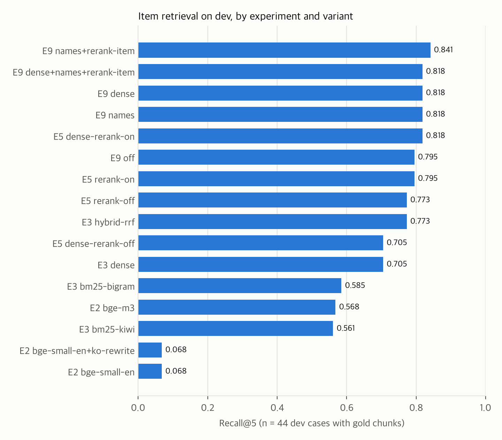
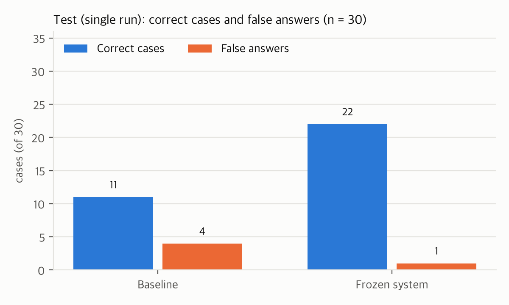
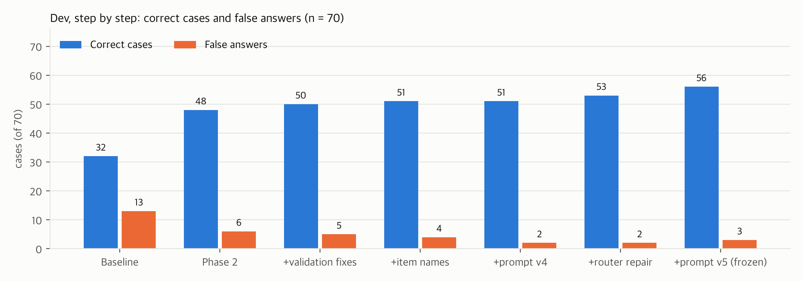
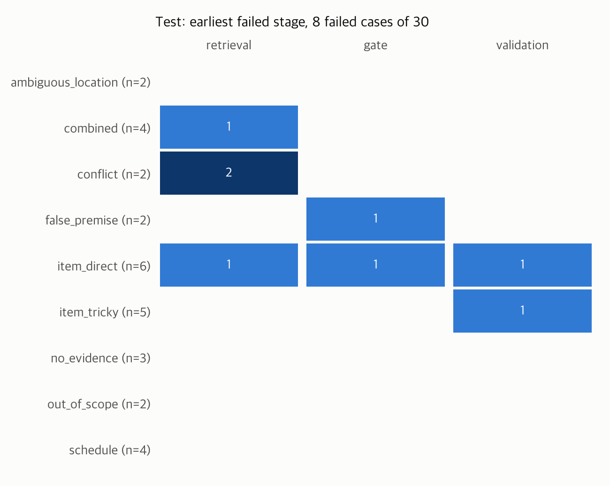

# Waste-Sorting Assistant for Foreigners in Korea

<p class="subtitle">Final report · 202620HY33390 Design of Generative AI Application Systems, Hanyang University · Team: Shukurullo (system), Vitou (data), Anar (evaluation and report), Naura (website) · 2026-11-08</p>

> **In one paragraph.** A foreigner in Korea asks, in their own language, which bin an item goes in and when waste is collected in their neighbourhood. The assistant answers from two official sources: the national separation guides for items, and the district collection table for days and places. It cites both. When it cannot answer safely, it says so and hands off to the district office with a Korean sentence the user can show. On a frozen test split of 30 cases that the system never saw while it was tuned, it got 22 of 30 cases right, with 1 false answer (answering when it should not, or with the wrong bin). The Phase 1 baseline scored 11 correct and 4 false answers on the same cases. Every question that should have been refused or asked back was handled correctly, and every schedule shown was the right one. The main weaknesses are the router's translation of item names into Korean (the cause of 5 of the 8 test failures), outdated 2018 entries that outrank newer 2026 rules, and a 7B model that sometimes contradicts its own evidence. Validation turns most of these into abstentions with a handoff, so 7 of the 8 test failures reached the user as "I can't confirm this, ask the district office", not as a wrong bin.

## 1. Problem, users, scope (Lesson 1)

**Users.** International students and other foreign residents who do not read Korean well, mainly in Seoul.

**Questions.** "Which bin does this item go in, and how do I prepare it?" (item questions) and "When and where can I put out food waste in 행당1동?" (schedule questions), or both at once.

**Why it matters.** Mistakes mean trash left uncollected, fines, and friction with neighbours. The official rules are in Korean PDFs and a 10,187-row spreadsheet.

**Non-goals.** Business waste, construction waste, scrapping a car, fines and prices, and anything outside household waste in Korea. These are refused (`OUT_OF_SCOPE`) or handed off.

**Cost of errors.** A confident wrong bin costs the user more than an abstention. So the system is built to abstain when its evidence is weak, and the main safety number is the **false-answer rate**.

## 2. Data sources and their quality (§3)

| Source | Used for | Size | Notes |
|---|---|---|---|
| Ministry of Environment, *Recycling Separation Guideline* (2018), 36 pages | Item bins, FAQ, general rules | 293 items, 36 FAQ, 20 guide pages | Food-waste tables on p.17–18 lost their layout in PDF extraction: 9 rows transcribed by hand |
| Separation directive, Annex 1 (effective 2026-01-01) | Current rules by material group | 42 rules, 3 notes | Some items changed since 2018 (clear PET bottles, small electronics) |
| data.go.kr household-waste collection table (CP949) | Days, times, places, method, office phone | 10,187 rows, 222 districts | 61% of rows are over a year old; Seoul 강동구 and 도봉구 have no rows; 7 district names exist in several provinces |

The data work was done before any tuning, following the lesson "do not measure on known-bad data". It included:
- stable UUIDv5 chunk IDs;
- splitting area lists such as `휘경1,2동`;
- keeping the province, so the seven duplicated district names (such as 중구) can be told apart;
- a romanised-to-Korean alias table (1,723 aliases);
- flagging stale rows.

Details: `data/reports/data_quality.md`, `docs/PHASE2_NOTES.md` §1.

## 3. Ingestion contract and index verification (Lesson 3)

The 403 item chunks (`data/processed/item_chunks.jsonl`) are embedded with **BAAI/bge-m3**, pinned by revision, into a local Qdrant collection. The collection's name includes the model revision and the corpus hash (`items_bge-m3_5617a9f6_c7d19676`). The pipeline refuses to run if the corpus hash does not match, so old and new chunks are never mixed. Each build is verified before it is published: point count, no duplicate IDs, and a test that every chunk retrieves itself (`ingest/verify_index.py`).

Schedules are **not** embedded for answering. The rows are near-duplicates that differ only in the district name, so vector search returns the wrong district (E4, §8).

## 4. Representation and embedding choice (Lesson 2, E2)

The corpus is Korean, while questions come in six languages. **E2** (dense retrieval only, the original question as the query, n = 44 dev cases with gold chunks):

| Embedding | Recall@5 | MRR |
|---|---|---|
| bge-small-en (course default, English only) | 0.068 | 0.064 |
| bge-small-en, query rewritten into Korean | 0.068 | 0.069 |
| **bge-m3 (multilingual)** | **0.568** | **0.474** |

An English-only model cannot represent Korean chunks at all, even when the query itself is Korean. bge-m3 is the only usable option.

## 5. Retrieval design (Lessons 4–5)

```
question ─► router (qwen2.5:7b, JSON): intent, item, Korean item name + query, district/dong, waste type, day
         ─► item retrieval: dense (bge-m3) + BM25 (kiwi) for the question and its Korean rewrite,
            + item-name search (router's item name vs chunk names)  ─► RRF (k = 60) ─► top 20
            ─► cross-encoder rerank (bge-reranker-v2-m3, best score over all queries) ─► top 5
         ─► schedule tool: typed lookup over the table (province, district, area), dates computed in code
         ─► gate: answer / abstain (top rerank score < τ) / ask back (ambiguous place) / out of scope
```

**Router.** The router extracts the item and a Korean rewrite. Its output is checked against the question: the item must appear in it, the rewrite must be Hangul, a negation must be kept, and a place must be one the question mentions. A rewrite that fails these checks is not used.

**Retrieval experiments on dev** (Recall@5 / MRR, n = 44):

| Experiment | Variant | Recall@5 | MRR |
|---|---|---|---|
| E3 | dense | 0.705 | 0.600 |
| E3 | BM25 (kiwi morphemes) | 0.561 | 0.433 |
| E3 | BM25 (character bigrams) | 0.585 | 0.494 |
| E3 | hybrid (RRF) | 0.773 | 0.583 |
| E5 | hybrid + rerank | 0.795 | 0.678 |
| E5 | dense + rerank | 0.818 | 0.693 |
| **E9** | **hybrid + rerank + item names** | **0.841** | **0.730** |
| E9 | dense + rerank + item names | 0.818 | 0.713 |



- **Hybrid beats dense before reranking** (E3: three cases better, none worse). BM25 alone is weak on English and Uzbek questions.
- **The reranker adds 0.02–0.11 Recall@5.** With the reranker, dense alone is about as good as hybrid: 0.818 vs 0.795, one case apart.
- **E9, item-name search, was added in Stage 3.** It came from the dev failure analysis: 9 of the 22 failed cases had a wrong or unusable Korean rewrite, such as 퍼플라이트 for a fluorescent tube or 참외 (Korean melon) for pineapple. The router's item name is matched against each chunk's short item name, not the whole chunk. For example, "pineapple peels" then finds 파인애플껍질 and "batteries" finds 전지. Together with reranking on the item name, Recall@5 rose from 0.795 to 0.841 with no case worse. With dense instead of hybrid it was 0.818 and one case worse, so BM25 stays.
- **These differences are 1–2 cases out of 44.** They are not statistically separable, and we do not claim they are. We chose by "no case worse" plus the full-system result (§8).

**Gate threshold (E5 τ sweep).** The gate abstains when the best rerank score among the 5 evidence chunks is below τ. On dev, every τ from 0.03 to 0.65 gives zero false positives. Only 2 item cases that should be refused reach the gate (0.029 and 0.032); the Phase 2 probes add one more at 0.039. We **kept τ = 0.15**. A τ just above 0.039 would answer 3 more cases (h31 at 0.051, item14 at 0.068, h23 at 0.084), but h23 would be answered from the wrong evidence (glass-bottle chunks for a PET-bottle question). A threshold 0.01 above the highest negative seen is not trustworthy with three negatives. This is a judgement call, and it is recorded here.

**Schedule lookup (E4).** These are the 23 dev cases that need a schedule or a place: the schedule, combined and ambiguous_location slices.

| Variant | Correct | Gold row shown | Only gold rows | Another district's rows | Asked back when ambiguous |
|---|---|---|---|---|---|
| **Structured lookup** (province, district, area; code) | **23/23** | **19/19** | **18/19** | **0** | **4/4** |
| Vector search over the rows | 18/23 | 18/19 | 0/19 | 8 | 0/4 |
| Vector, then filter by district | 19/23 | 19/19 | 2/19 | 0 | 0/4 |
| Filter by district, then vector | 19/23 | 19/19 | 2/19 | 0 | 0/4 |

The rows of different districts are near-duplicates, so plain vector search showed another district's days in 8 of 19 cases. Filtering fixes the place, but it still shows the neighbouring zones of the district (only gold rows: 2/19). No vector variant can ask back for a district name that is used in several provinces, because it always returns some rows. The structured lookup was kept.

## 6. Generation contract, validation and handoff (Lessons 1, 4, 7)

**Generator.** qwen2.5:7b through Ollama, with temperature 0 and seed 7. Output is constrained to a JSON schema: status, bin, how_to_prepare, answer_text with `[n]` citations, citations and missing. The context is built under a token budget (8,192-token context, 768 reserved for the answer). The generator sees **item evidence only**: days, times and places are written by code from the table, in the user's language. In Phase 2 the LLM dropped and invented days in 7 of 19 schedule answers, and writing them in code fixed that. The LLM only translates the free-text method line, with its own prompt.

**Prompt versions (E1).** Only the prompt changes between these variants; retrieval, gate and validation stay the same (dev, n = 70, router repair off):

| Prompt | What it adds | Correct | False answers | Bin | Unsupported 종량제봉투 |
|---|---|---|---|---|---|
| v0 | minimal instruction | 32 | 2 | 8/45 | 4 |
| v1 | zero-shot contract (rules + JSON schema) | 48 | 4 | 24/45 | 3 |
| v2 | + three worked examples | 51 | 4 | 27/45 | 5 |
| v3 | + "no steps from the examples" | 49 | 5 | 25/45 | 7 |
| v4 | + a rule for wrong premises; schedule example replaced | 51 | 2 | 27/45 | 8 |
| **v5** | **v4 with the example bins balanced** | **54** | **3** | **30/45** | **2** |

- **The contract does most of the work.** v0 → v1 is +16 cases. Without the contract, v0 seldom names a bin (8/45). Its 2 false answers are low only because it rarely answers.
- **The examples leak their bins.** "Unsupported 종량제봉투" counts the answers that named the general waste bag although the case does not accept it. In v4 all three examples show 종량제봉투: the pen, the cushion of the false-premise example, and both distractors of the abstention example. The model then said 종량제봉투 against its evidence in 8 cases: metal cans, bubble wrap and spoiled food among them. v5 changes only the examples: the false-premise example became a metal kettle that goes with scrap metal (고철), and one distractor became iron tools (고철). Unsupported 종량제봉투 bins fell to 2, and v5 is worse than v2 on no case and better on three (h03, h37, h73). Validation had caught most of the v4 cases, as abstentions, so the gain is mostly in correct answers, not in false answers.
- **Every example item was checked against all 100 cases** (Korean, English, Russian, Chinese, Vietnamese and Uzbek words), so no case can be answered by copying an example.
- **Caveat.** v5 is the best of six prompts on the same 70 dev cases, so its dev score is optimistic. The test split (§8) is the check.

**Conflict policy (E8).** By default the prompt tells the model that when the 2018 guide and the 2026 rules disagree, the 2026 rule applies. Without that sentence, dev was 57/70 correct with 4 false answers, against 56/70 and 3 with it: one case each way, which is noise. We kept the rule because it states the actual legal order. Neither variant solves the **conflict slice** (0/6 and 1/6 on dev). In these cases both years are retrieved, and the 7B model still answers with the 2018 bin, or with general waste, as for the thermometer (h26). This is the weakest slice: see §9.

**Router repair.** When the Korean rewrite fails its script check (for example `기름occo散布的纸张`), the router is asked once more, with the reason. On dev this rescued two Uzbek cases (h08, item14) and made none worse, so it is on.

**Validation (enforce mode).** Any failed check turns an `ANSWER` into `INSUFFICIENT_CONTEXT` with a handoff. The checks are:
- **The bin is a known category** (18 canonical bins and their aliases, `rag/bins.py`).
- **The cited chunks state that bin.** These are their 2018 categories or their 2026 rule group; for chunks that state no bin, it is a text match.
- **The bin field agrees with the bins named in the text.**
- **The answer cites at least one chunk.**
- **No invented days or times.** An answer must not state days or clock times that its sources do not contain. Stage 3 extended this from schedule answers to item-only answers, after dev item10 copied "Tue, Thu, Sat 19:00–23:00" from a few-shot example into an answer about spoiled food.

Stage 3 also fixed two gaps in the bin checks. A 2026 sub-item that is itself a bin now decides: 종이팩 under 골판지 외 종이류. And an empty bin field is filled from Korean bin names in the text, such as 폐가전제품.

**Answer contract.** Every answer fits a typed contract (`rag/contract.py`, schema in `docs/answer_schema.json`) with rules between fields. For example, `CLARIFY` needs a question, and an abstention needs a handoff. All 49 Stage 1 probes and every evaluation answer satisfied it: **0 contract problems in 550 evaluation answers** (the 7 dev runs and the 2 test runs in `eval/reports/`).

**Handoff (Lesson 7, Klarna).** An abstention gives the user:
- the district office and its phone number;
- a Korean sentence to show the staff, written by code, never by the LLM;
- what the assistant checked.

The fixed texts are written in six languages (`rag/texts.py`). The zh, vi, uz and ru drafts have not been checked by a native speaker.

## 7. Evaluation method (Lesson 6)

**Cases.** There are 100 cases in 9 slices (`eval/cases/`, schema in `eval/cases.py`):
- 65 hand-written cases (tricky items, 2018/2026 conflicts, false premises, no evidence, ambiguous places, out of scope, combined item + schedule);
- 20 item cases from templates over the item dictionary;
- 15 schedule cases from templates over the table, one per district.

Gold chunk IDs and gold schedule rows come from scans of the data (`eval/label_helper.py`), never from the system's own output.

**Split.** The split is 70 dev / 30 test, stratified by slice, with seed 20261108. Its SHA-256 hashes were frozen in `split_manifest.json` (commit `375e7d2`) **before any tuning**. Twelve cases already seen during development were forced into dev. All tuning (E1–E9, τ, the Stage 3 fixes) used dev only. The test split was run **once**, with the configuration frozen at commit `cf047ff` (§8). A test report lists no per-case rows, so nobody could tune on it.

| Slice | Dev | Test | Expected behaviour |
|---|---|---|---|
| item_direct | 14 | 6 | answer |
| item_tricky | 11 | 5 | answer |
| conflict (2018 vs 2026) | 6 | 2 | answer with the 2026 rule |
| false_premise | 6 | 2 | answer, correcting the premise |
| combined (item + schedule) | 8 | 4 | answer both |
| schedule | 11 | 4 | answer |
| no_evidence | 7 | 3 | abstain |
| ambiguous_location | 4 | 2 | ask back |
| out_of_scope | 3 | 2 | refuse |
| real_users | 0 | 0 | **missing**: no real student questions were collected |

Languages: dev has en 25, ko 22, uz 7, zh 6, ru 6 and vi 4. Test has en 15, ko 8, vi 3, ru 2 and zh 2, and **no Uzbek case**, so Uzbek is measured on dev only.

**Metrics** (`eval/metrics.py`; undefined values are counted, not hidden):
- **Case correct.** For answer cases: `ANSWER`, the bin in the expected set, and a gold row shown where a schedule is expected. For the others: the expected behaviour.
- **False answer.** `ANSWER` when the case should not be answered, or `ANSWER` with a bin outside the expected set. This is the costly error.
- **Item withheld.** For a combined question, the item part can be refused while the schedule is still answered, with a sentence saying the item could not be confirmed. That is not correct, but it names no wrong bin, so it is counted on its own and not as a false answer. Until Stage 3 the code counted it as a false answer, contrary to the definition above. This was fixed before the test run, and every dev report was scored again from its saved traces (`python -m eval.run_eval --name <report> --rescore`). The baseline went from 21 to 13 false answers on dev, 8 of them withheld items.
- **Retrieval:** Recall@5, MRR, nDCG@5 and P@5 on the reranked order.
- **Gate:** TP/FP/FN/TN. **Schedule:** gold row found, and only gold rows shown.
- **Citations:** whether a gold chunk is cited, and citation precision.
- **Language:** whether the answer is in the asked language's script.
- **Latency per stage.**
- **Failure stage:** for every failed case, the earliest stage that went wrong, labelled by rule from its trace.

**LLM judge.** Ragas 0.4.3 measured faithfulness and context relevance, with **exaone3.5:7.8b** (LG AI Research, digest `c7c4e3d1ca22`) as the judge. The judge comes from a different model family than the generator, so the system does not grade its own answers. It still is a 7.8B model, so its scores need a human check (§8.3, §11).

**Statistics.** With 30 test cases, every rate is shown as a count ("26/30"). One case is 3.3 points, so differences of one or two cases are noise. The template cases are not independent of each other.

## 8. Results (Lesson 5)

### 8.1 The test split: one run of the frozen system

The configuration was frozen at commit `cf047ff` (`rag/config.py`): hybrid retrieval with item-name search, the reranker on all queries, τ = 0.15, router repair, prompt v5, the 2026 conflict rule, validation in enforce mode, and the structured schedule lookup. Test was then run once, with no reply cache. The only file changed during the run was this report, which the pipeline does not read. The **baseline** is the Phase 1 system on the same 30 cases: dense bge-m3 retrieval of the original question, no router, no reranker, no gate, no validation, and prompt v1.



| Metric (test, n = 30) | Baseline | **Frozen system** |
|---|---|---|
| Case correct | 11/30 | **22/30** |
| **False answers** (the costly error) | 4/30 | **1/30** |
| Item withheld (schedule only, not a false answer) | 5 | 1 |
| Bin correct (answerable item cases) | 5/19 | 11/19 |
| Abstained when it should | 3/5 | 5/5 |
| Asked back for an ambiguous place | 0/2 | 2/2 |
| Gold schedule row shown / only gold rows | 7/8 / 7/8 | 8/8 / 8/8 |
| Retrieval Recall@5 / MRR (n = 19) | 0.526 / 0.393 | 0.684 / 0.470 |
| Gate TP / FP / FN / TN | no gate | 15 / 1 / 4 / 2 |
| Cites a gold chunk / citation precision | 8/13 / 0.58 | 7/12 / 0.58 |
| Answer in the asked language | 18/18 | 13/13 |
| Contract problems | 0 | 0 |
| Latency, median (s) | 9.4 | 21.7 |

By slice and language, frozen system on test (correct / cases):

| Slice | Test | Dev (same config) | | Language | Test | Dev |
|---|---|---|---|---|---|---|
| item_direct | 3/6 | 9/14 | | en | 10/15 | 18/25 |
| item_tricky | 4/5 | 11/11 | | ko | 7/8 | 21/22 |
| conflict | **0/2** | **0/6** | | ru | 2/2 | 5/6 |
| false_premise | 1/2 | 4/6 | | zh | 2/2 | 5/6 |
| combined | 3/4 | 8/8 | | vi | 1/3 | 2/4 |
| schedule | 4/4 | 11/11 | | uz | – | 5/7 |
| no_evidence | 3/3 | 6/7 | | | | |
| ambiguous_location | 2/2 | 4/4 | | | | |
| out_of_scope | 2/2 | 3/3 | | **All** | **22/30** | **56/70** |

- **Test is lower than dev: 73% against 80%.** That is the expected price of tuning six prompts and several retrieval options on dev. The gap is mostly in the item slices, where retrieval on test is also lower (Recall@5 0.684 against 0.841). Only 19 test cases have gold chunks, so one case is 5 points.
- **The safety numbers held.** On test, 1 false answer in 30. Every case that should be refused or asked back was handled: no_evidence 3/3, out_of_scope 2/2, ambiguous_location 2/2. All 8 schedule rows were right, and no other district's rows were shown.
- **The weakest slice is the 2018-vs-2026 conflict** (0/2 test, 0/6 dev): see §9.
- **The baseline is fast because it does less.** It has no router (7 s) and no reranker (6 s). Its "item withheld" count of 5 shows how often its answers covered only part of a combined question.

### 8.2 Dev, one change at a time



| Step (dev, n = 70) | Correct | False answers | Bin | Recall@5 |
|---|---|---|---|---|
| Baseline (Phase 1) | 32 | 13 | 17/45 | 0.556 |
| Phase 2 full system | 48 | 6 | 24/45 | 0.795 |
| + validation fixes (rule sub-items, bins named in the text, invented days in item answers) | 50 | 5 | 26/45 | 0.795 |
| + item-name search, reranking on the item name (E9) | 51 | 4 | 27/45 | 0.841 |
| + prompt v4 (wrong-premise rule) | 51 | 2 | 27/45 | 0.841 |
| + router repair | 53 | 2 | 29/45 | 0.841 |
| **+ prompt v5 (balanced examples) = frozen** | **56** | **3** | **32/45** | **0.841** |

Each Stage 3 step was measured on the full dev split. None made more than two cases worse, and the last two made none worse; the cases are listed in each experiment's `summary.md`. These runs replayed identical model requests from a reply cache (`--cache`), so their latencies are not valid. Only the uncached runs give latency: the Phase 2 system on dev and the test run.

### 8.3 Faithfulness with an LLM judge (Ragas)

The judge is exaone3.5:7.8b, a different model family from the generator. Of the 22 test answers, 17 had item or schedule evidence to judge.

| Test answers (n = 17) | Faithfulness | Context relevance |
|---|---|---|
| All | 0.854 | 0.868 |
| schedule (4) | 0.938 | 1.000 |
| combined (4) | 0.875 | 0.875 |
| item_tricky (4) | 0.900 | 0.875 |
| item_direct (3) | 0.667 | 0.750 |

- **Faithfulness is not correctness.** The one false answer (h25, electric toothbrush → general waste bag) scores faithfulness 1.0: it is faithful to the 2018 chunk it cites, which the 2026 rule overrides. The judge cannot see a rule that was never retrieved.
- **The low scores are of two kinds.** Some answers add steps from evidence about another item. h15, a broken mug (0.6), takes "wrap it in newspaper; buy a special bag for large amounts" from the broken-glass FAQ. h76, old books (0.67), paraphrases the paper rules beyond what they say. Others are **judge errors**: item05 (mop → 대형) and item15 (desk calendar → 종이) state exactly the bin of the chunk they cite, yet they score 0.5. We read the five lowest-scoring answers by hand to find this. A 7.8B judge on 17 answers is noisy, which is why the human audit is part of the plan.
- **These scores are unchecked by people.** The audit sheets for two raters (17 answers, `eval/reports/test-final/audit/`) are exported but not filled in yet. Until they are, the judge's agreement with humans is unknown (§11).

### 8.4 Robustness probes (test, 19 answer cases with gold chunks)

The probes change the evidence after retrieval and before the gate (`experiments/robustness.py`, RGB-style):

| Probe | What changes | Outcome |
|---|---|---|
| clean | nothing | right bin 11, abstained 7, wrong bin 1 |
| noise | 3 chunks about other items, with other bins, appended | same bin 11, abstained as in clean 6, 1 abstained that clean answered, 1 answered that clean refused; **no bin changed** |
| negative | every gold chunk removed; the next candidates move up | abstained 9, right bin anyway 6 (from an FAQ, a guide page or a similar item), **wrong bin 4** |
| counterfactual | a false chunk at rank 1, written like a 2018 entry for the asked item, with a wrong bin | **followed it 12**, abstained 4, right bin 3 |

- **Noise does not hurt.**
- **Missing evidence is mostly refused**: 9 of 19 abstained, and 6 more found the bin elsewhere. In 4 the model took the wrong bin from what was left: a similar item (machine oil for cooking oil), a general guide page (umbrella, shells), or the outdated 2018 entry (electric toothbrush, as in the clean run).
- **A false chunk that names the item is believed** in 12 of 19 cases. Validation checks that the cited chunk states the bin, so it passes a bin that a planted chunk states. This is the main threat if a wrong entry ever reaches the corpus. It also argues for keeping the corpus manifest and hashes (§10), and for future work 3 (§11).

### 8.5 Stability across sampling (E7, dev, 20 cases × 3 temperatures × 5 seeds)

| Temperature | Same status and bin under all 5 seeds | Abstention flips | Correct (range over seeds) | False answers (range) |
|---|---|---|---|---|
| **0.0** (used) | **20/20** | 0/20 | 12 | 1 |
| 0.7 | 8/20 | 11/20 | 6–11 | 1–4 |
| 1.0 | 6/20 | 12/20 | 8–9 | 2–6 |

At temperature 0 with a fixed seed the answer is reproducible: the same question gets the same answer. Sampling makes the system both less correct and less safe. The 20 cases are the first 20 of dev (item_tricky, conflict, false_premise), which are harder than average.

### 8.6 Latency

The median is 21.7 s per question on an Apple M3 Pro (36 GB) with local models (test run, no cache). The stages are the router 6.6 s, the reranker 5.9 s, the generator 13.8 s, and the schedule text 1.3 s (only when there is a schedule). The reranker is slower than in Phase 2 (3.4 s) because it now scores the item names as extra queries.

## 9. Failure analysis (Lesson 6)



The heatmap places each failed case at the **earliest stage whose check failed**, labelled by rule from its trace (`eval/metrics.py`). Rules see symptoms, so we also read all 8 failed test cases to find the root cause:

| Case (test) | Question | What happened | Root cause | Ends as |
|---|---|---|---|---|
| h25 conflict, ko | 전동칫솔 (electric toothbrush) | The 2018 entry (general waste bag) ranked first at 0.997; the 2026 small-electronics rule was not in the top 20 | Retrieval of the newer rule | **False answer** |
| h27 conflict, en | plastic toy car, no batteries | The model said 플라스틱 (right), but the 2026 plastic-toy rule was not retrieved; the cited 2018 toy chunk states other bins | Retrieval of the newer rule; Korean name `플라스틱 장난감 카ars` | Validation refusal |
| h04 item_tricky, en | broken drinking glass | Korean name `_GLASS_`, repair failed; the model named 불연성종량제 (right) but cited the glass-bottle chunks, not 깨진 유리 at rank 2 | Router name; wrong citation | Validation refusal |
| item04 item_direct, en | baby formula can | The model named 고철 (right) but cited the 2026 금속캔 rule, which states another accepted bin | **Validation too strict** | Validation refusal |
| h36 false_premise, vi | "fluorescent lamp is glass, right?" | Korean name `linky bulb`, repair failed; the gold chunk ranked first but scored 0.004 | Router name | Gate refusal |
| item07 item_direct, en | cracked ttukbaegi | Korean query with a Chinese character (`璺은 토기`); gold at rank 4, score 0.008 | Router name | Gate refusal |
| item12 item_direct, en | old scarf | Korean name `구loth`; gold not retrieved | Router name | Gate refusal |
| h78 combined, vi | styrofoam box from electronics | "Hộp xốp" (styrofoam box) translated as "box for electronic items" | Router translation | Item withheld, schedule right |

- **The router's Korean item name is the root cause in 5 of 8**, and it is involved in a sixth (h27). The router's checks catch output that is not Korean (`linky bulb`) or that drops the item (`_GLASS_`). They do not catch a wrong but fluent Korean name, or a Hangul syllable glued to Latin letters (`구loth`, `카ars`). The strict check allows Latin letters so that names such as `PET병` pass.
- **7 of the 8 failures end as a refusal or a withheld item**, which is the intended failure mode. Only h25 reached the user with a wrong bin.
- **Validation cost two correct bins** (item04, h04). In both, the model named a right bin but cited a chunk that states a different bin. The rule "the cited chunk must state the bin" trades these for the false answers it stops. On dev with the frozen config it refused 5 answers: 4 had named a wrong bin, and 1 was unreadable output.
- **Conflict cases fail in two ways.** On test, both failures are in retrieval. The 2026 rule is not among the 5 evidence chunks, because the 2018 entry names the item exactly while the 2026 rule names a group ("small electronics"). On dev, the right 2026 rule *was* in the evidence in 4 of 6 cases (h21, h22, h26, h28). The 7B model still named an older or nearby bin: 플라스틱 or 재질별분리 for a clear PET bottle, 고철 or 종량제봉투 for a small appliance. Validation refused three of these. h26 passed, because its cited 2018 chunk states 종량제봉투.

### Case studies

**1. Few-shot examples leak their bins (dev, Stage 3).** After prompt v4 added a false-premise example, all three examples showed 종량제봉투. The model then answered "general waste bag" for metal cans (h79), bubble wrap (item09) and spoiled food (item10), where its evidence said otherwise. Validation refused the first two. The third passed, because the text of a cited chunk mentions the general waste bag. Changing only the example bins (v5: a kettle → 고철) cut unsupported 종량제봉투 bins from 8 to 2, and correct cases rose from 51 to 54. Lesson: an example teaches its *answer*, not only its format. That is why we checked the example items against all cases.

**2. Pineapple becomes Korean melon (dev h07, Stage 3).** "How do I throw away pineapple peels?" was rewritten as 참외 (Korean melon), so the retrieved chunks were about melons. A rewrite in the wrong language can be caught, but a wrong rewrite in fluent Korean cannot. The fix was to stop relying on one translation. The router's item name is also embedded and matched against each chunk's short item name (E9), so "pineapple peels" finds 파인애플껍질 directly. Recall@5 rose from 0.795 to 0.841, with no case worse.

**3. The electric toothbrush (test h25), the one false answer.** "전동칫솔은 어떻게 버려야 하나요?" The 2018 guide has an entry for exactly this item: general waste bag. The 2026 rule moved battery-embedded small appliances to the small-electronics collection, but it names a group, not the toothbrush, so it was not retrieved. Every check passed: the bin is known, the cited chunk states it, and the judge gives faithfulness 1.0. **Grounding is not correctness when the source is outdated.** A fix would retrieve the 2026 rule group of an item explicitly, by mapping 2018 categories to 2026 groups, before generation.

**4. The baby formula can (test item04): validation refuses a right answer.** The model said scrap metal (고철), which is correct, and cited the 2026 metal-can rule, which says metal cans (금속캔). The case accepts both bins, but validation compares the stated bin with the cited chunk's bin and refused. This is the price of a strict rule. Accepting any bin from a known equivalence set (고철 ≈ 금속캔 for food cans) would recover it, but the set would have to be written and checked by people.

**5. An Uzbek light bulb (dev item08): a wrong bin that validation cannot catch.** "Kuyib qolgan cho'g'lanma lampochka" (a burnt-out incandescent bulb) produced no Korean item name and a garbled query, so fluorescent-lamp chunks were retrieved. The model answered 전용함 (the fluorescent-lamp box) in Uzbek that drifts into another Turkic language in Cyrillic, citing a fluorescent-lamp chunk that does state that bin, so validation passed it. The cited chunk is about a different item. Future work 3 (§11) is a check that the cited chunk names the asked item.

## 10. Industry lens and maintenance (Lesson 7)

| Lens | Our application |
|---|---|
| Problem | Foreign residents can't read the Korean rules and don't know their district's schedule |
| Application | RAG over the national rules plus a deterministic lookup over district data, multilingual, with citations and a handoff |
| Pros | Available 24/7 in the user's language; national and local rules in one place; sources and data dates are visible |
| Cons | Stale district data (61% of rows over a year old); national guides can differ from local practice; a 7B model mistranslates rare item names and sometimes contradicts its evidence |
| Improvement | Prefer the newer source; show data dates; abstain below a threshold; hand off with a Korean sentence; validate every bin against the cited evidence |
| Measurement | Bin correctness and false answers on a frozen test set, by slice and language; faithfulness with a judge, to be checked by people. In deployment, the 👍/👎 feedback saved by `trace_id`, and repeat questions |

**Maintenance.** Every source has a hash and a date in `data/processed/manifest.json`. A change to the chunks changes the corpus hash, which forces a rebuild of the index: the pipeline will not run on a mismatch. The district table should be refreshed from data.go.kr every month, with stale rows flagged to the user in the meantime.

## 11. Limitations, risks, responsible use, future work

**What was not done (and must not be read into the numbers).**
- **No real users.** The `real_users` slice is empty: no real questions from international students were collected.
- **The cases were written by the system's developer** (with AI assistance), not by an independent person. The paraphrases in zh, vi, uz and ru were not checked by native speakers. A developer who also wrote the system tends to write questions the system can parse. So the test score is an optimistic estimate, even though the test split was never used for tuning.
- **No human audit yet.** The plan asks two people to label about 20 answers independently. The test run produced 17 answers with evidence, and blank sheets for both raters are exported (`eval/reports/test-final/audit/`). `python -m eval.audit agree test-final` computes human faithfulness, Cohen's kappa between the raters, and the judge's agreement with them, once the sheets are filled. Until then, the judge's scores are unchecked. Our own reading already found two judge errors (§8.3).
- **No native-speaker check** of the glossary, the day and label tables, or the fixed texts in zh, vi, uz and ru.

**Known weaknesses.**
- **Low-resource languages.** The 7B router mistranslates or garbles Uzbek and Russian item names: `기름occo散布的纸张` for frying oil, `투명 플라스틱 수저` (spoons) for PET bottles. The Uzbek answers it writes are often not fluent. The test split has no Uzbek case, so Uzbek is measured on dev only: 5/7 correct, with 1 false answer (item08, case study 5). On test, the router's item name caused 5 of the 8 failures (§9).
- **The model contradicts its own evidence.** Examples: pineapple peel into food waste, and a thermometer into general waste although a 2026 rule says small electronics. Validation catches this when the bin it names is not the bin the cited chunk states. It cannot catch a wrong bin that a cited chunk supports: an outdated 2018 entry (h25), a chunk about a similar item (item08), or a planted false chunk (12 of 19 in the counterfactual probe, §8.4). It also cannot catch wrong preparation steps.
- **Outdated entries outrank newer rules.** A 2018 entry that names the item beats a 2026 rule that names its material group. The conflict slice is 0/2 on test and 0/6 on dev.
- **Stale and incomplete district data.** 61% of the rows are over a year old (shown to the user), and 강동구 and 도봉구 have no rows.
- **Latency.** About 22 s per question (median, test run) on an Apple M3 Pro with local models: the router about 7 s, the reranker about 6 s, the generator about 14 s. Too slow for a chat feel, but acceptable for a lookup.
- **Small test set.** With 30 test cases, one case is 3.3 points.

**Responsible use.** The page:
- says that the answers come from official guides that can differ from building or district practice;
- shows each source and its data date;
- marks old data;
- never shows a bin when it abstains.

Feedback is stored with a trace ID and an optional comment, and no personal data is asked for. The location is a district and neighbourhood, never a street address.

**Future work, in order of expected value:**
1. A reviewed table of Korean item names in the user languages, to replace LLM translation of item names. This needs native speakers. It addresses the largest failure cause on test.
2. Retrieving the 2026 rule group of an item explicitly, through a reviewed map from 2018 categories to 2026 groups, so a newer rule cannot be outranked (h25, the conflict slice).
3. A check that a cited chunk is about the asked item, not just a chunk that states the bin (item08, the counterfactual probe).
4. A stricter script check for Korean names (no Hangul glued to lowercase Latin, as in `구loth`), and a stronger or specialised model for Uzbek and Russian routing.
5. The human audit, then real-user questions as a new evaluation slice.
6. Caching the router and reranker for frequent items, to cut latency.
