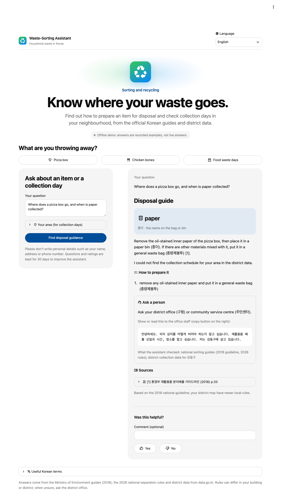
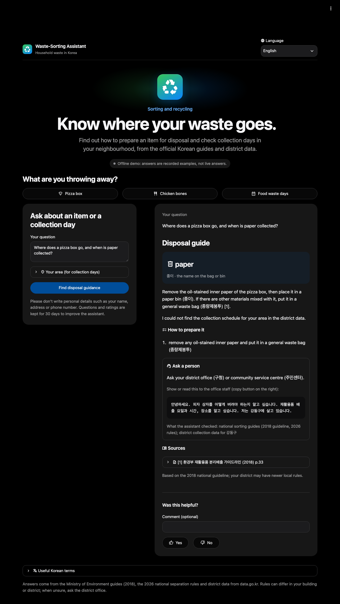
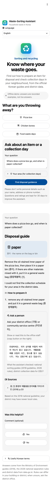
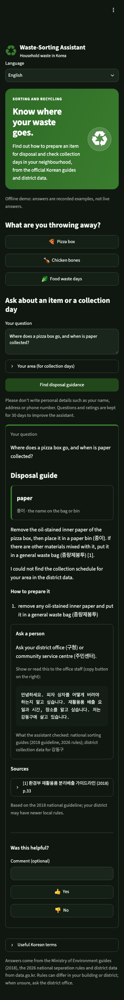

# Connecting the website

Everything the page needs comes from one module, `rag/service.py`. Every answer it returns fits
the contract in `rag/contract.py`. The full schema, generated from that file, is
[answer_schema.json](answer_schema.json), and [answer_examples.json](answer_examples.json) has
13 real answers covering every case below.

## What to call

```python
from rag import service

answer = service.ask(question, lang="en", district="성동구", dong="행당1동")
service.ask(question, progress=callback)   # callback("queued" | "loading" | "route" |
                                           #   "retrieve" | "schedule" | "write") as it happens
service.save_feedback(answer["trace_id"], "up")    # or "down", with an optional comment
service.locations()   # dropdown data: [{province, district, district_en, has_data, zones: [{zone, areas}]}]
service.languages()   # {"en": "English", "ko": "한국어", "zh": "中文", "vi": ..., "uz": ..., "ru": ...}
service.glossary()    # 36 waste terms in all six languages, for hover text
service.health()      # {"offline", "ollama", "pipeline_loaded", "model", "trace_retention_days",
                      #  "data_review_overdue"}; asks Ollama at most every 10 s
service.pipeline_settings()   # models and Ollama digests once loaded (maintainer view)
```

- **`ask()` never raises for a question.** If Ollama is down or something breaks, the answer is an
  abstention with a handoff, and the error goes to `traces/errors.jsonl`. An empty question
  raises `ValueError`, so check for it in the page.
- **Except when it is busy.** When `MAX_QUEUE` questions (5; `RAG_MAX_QUEUE`) are already being
  answered or waiting, `ask()` raises `service.Busy` rather than keep a sixth visitor waiting
  for minutes. The page then asks them to try again in a minute and keeps their question. A
  cached answer still comes.
- **A repeated question is answered at once.** `ask()` keeps the last 512 answers in memory,
  by the day in Korea, the question, the language and the area. Asked again on the same day,
  the question gets the same answer without the pipeline, which would give that answer anyway
  (temperature 0, a fixed seed, dates worked out per day). Each repeat is still a line in
  `traces/`, with `cached_from` naming the trace of the answer, and the answer keeps that
  `trace_id`, so a 👍/👎 on it reaches the full trace. A failed ("not available") answer is
  never kept. The memory is empty again after a restart.
- **The first question takes about 20 s**, because two models load (the page starts loading them
  in the background when it opens). After that a question takes 15–25 s. Pass `progress` to show
  what is happening. `ask()` is told `"queued"` when another question is being answered (one
  local LLM answers one at a time) and `"loading"` while the models load.
- **Location:** pass `district` and `dong` from the dropdowns, using the Korean names in
  `locations()`. Leave them out if the user didn't choose. The router then reads the location
  from the question (`"I live in Seongdong-gu Haengdang-dong"`).
- **Districts with `has_data: false`** (도봉구, 강동구) are real districts with no data. Keep
  them in the list: the assistant says it has no data and gives the office instead.

**Offline mode:** set `RAG_OFFLINE=1` before starting the page, and `ask()` returns the recorded
examples with no Ollama and no models. An exact example question returns its own answer, and any
other question gets an example marked as such in `notes`.

## What to show, by `status`

| `status` | Show |
|---|---|
| `ANSWER` | `answer_text`, the bin card (`bin_en` with `bin`), `how_to_prepare`, the schedule card if `schedule` is set, source cards, `notes`. Also `handoff` and `clarify` if present: an answer can cover only one part of the question. |
| `CLARIFY` | `answer_text`, then `clarify.question` with `clarify.options` as buttons. When the user picks one, ask again with it filled in (see below). |
| `INSUFFICIENT_CONTEXT` | `answer_text` and the handoff card. Never show a bin. |
| `OUT_OF_SCOPE` | `answer_text` only. |

## Field by field

| Field | How to show it |
|---|---|
| `answer_text` | **Keep the line breaks.** It has several lines, and `[n]` marks cite `citations[n]`. A partial answer says in its first or last line which part failed. |
| `bin`, `bin_en` | `bin_en` big, `bin` (Korean) small: the Korean is what's printed on the bags. |
| `how_to_prepare` | A numbered list. |
| `schedule.zones[]` | One card per zone: `zone`, `areas`, `place`, then for each type in `by_type` its `days`, `start`–`end` and `next_dates`. `day_check` answers "tonight?"-style questions. Show `no_collection` and `stale`. |
| `citations[]` | Source cards: `source`, then `page` and `year` for guides or `data_date` for district rows, with `text` in an expander. `text` is the Korean evidence the model read. |
| `notes` | Small grey lines under the answer, already in the user's language. |
| `handoff` | A card: `contact` (who to call), `phone` as a `tel:` link, `korean_sentence` in large text with a copy button (it's for the office staff), and `checked` as a list. |
| `clarify.options` | Up to 30 buttons. The values are Korean place names, so show them as they are. |
| `data_date`, `office_phone` | Flat copies for a one-line summary. The same values are in the zone cards. |
| `missing` | Don't show it. It's a diagnostic for us, in English. |
| `trace_id` | Hidden. Send it with feedback. |

**Answering a clarify option.** For `kind: "province"` the option is `"서울특별시 중구"`, so call
`ask(question, province="서울특별시", district="중구")`. For `"zones"` or `"names"`, call with the
same district and `dong=option`. For `"district"`, show the district dropdown.

## Languages

Fixed text is written by code in all six languages: status messages, clarify questions, handoff
lines, notes, schedule labels and no-collection days (`rag/texts.py` TEXTS,
`rag/schedule_text.py`). The page's own labels, headings, buttons and status lines are in the same
file (`PAGE`). The item answer is written by the LLM in the user's language. The zh, vi, uz and ru
tables are drafts that still need a native speaker's check. For vi, uz and ru, the free-text "How"
line of a schedule is shown in English (`docs/PHASE2_NOTES.md` §10). `tests/test_texts.py` checks
that every language has every key with the same placeholders, and that every label the page asks
for exists.

## The page



| | | |
|---|---|---|
|  |  |  |

### Files

| File | What it holds |
|---|---|
| `app/streamlit_app.py` | The layout (question and answer side by side on a laptop, the answer below the question on a tablet or a phone), the callbacks and the answer flow |
| `app/ui/components.py` | One render function per part of an answer (bin, steps, zones, sources, handoff, clarify, feedback, glossary, maintainer panel) |
| `app/ui/state.py` | Rules testable without a browser: session defaults, the starting language, the area check, the limits per tab and per visitor |
| `app/ui/style.css` | The page width (1040 px at most), when the two sides wrap, the app icon, the hero, the grey tiles and the bin card with its lit sign; everything else is the theme. The brand element carries it, so it takes no space of its own |
| `.streamlit/config.toml` | The theme in Apple's style (system font, Apple blue, pill buttons) in light and dark, no usage statistics, no developer menu, no tracebacks for visitors |
| `deploy/public_link.sh` | A public https link to the website on this Mac, through a Cloudflare tunnel ([below](#a-public-link-from-this-mac)) |

### What it does

- **Language.** One selector sets the page and the answer language. It starts from `?lang=` in the
  link, then the browser's language, then English, and writes `?lang=` back so a link can be
  shared. `<html lang>` follows it, so a screen reader uses the right voice.
- **Form.** The question box; three example questions per language (the language's recorded
  example where there is one, so the offline demo shows a real answer); and an optional area:
  province, district (all 224, marked "no data" where the table has none) and neighbourhood or
  zone, from `locations()`. The pickers are not in an `st.form`, so a new province refreshes the
  district list at once. A district that is not in the chosen province is never sent
  (`state.area_request`). Under the district box, the page says whether that district's
  collection days are in the data, or, before one is chosen, how many districts are (222 of
  224). The neighbourhood box is empty and disabled in two cases, and it
  says why: no district chosen yet ("Choose a district first"), or a district whose data has
  no neighbourhoods, 39 of the 222 with data ("Not needed: the answer covers the whole
  district"). Their data has one schedule for the district, or a few zones that the answer
  lists one by one (포항시남구, 포항시북구).
- **Asking.** The button only stores the request. The next run shows every input disabled and a
  status box that names the stage as it starts: "Reading your question…", "Searching the official
  guides…", "Checking your district's collection data…", "Writing the answer…", or "Another
  question is being answered. Yours is next…". Then the page reruns with the answer. No click can
  interrupt a question halfway, and a failure in the page itself gives the "not available"
  answer with a handoff, never a page with disabled inputs. Each browser tab can ask 8
  questions in 5 minutes, and each visitor 20, however many tabs they open. A visitor is a
  public IP address. Behind Docker, on a home network or on this machine, many people share
  one address, so there only the per-tab limit counts.
- **Layout.** The page is at most 1040 px wide. The question and the answer sit side by side
  while both fit (the question at least 320 px wide, the answer 440 px, so a window of about
  1000 px or more). Below that, the answer comes under the question at full width, and the
  page scrolls to a new answer when it is out of sight. On a phone the brand and the language
  box share one row.
- **ANSWER:** the bin card (a lit green-blue sign with the bin, in a slow ambient light that
  stops before the text; still for visitors who ask for less motion), `answer_text`, preparation steps, one card per zone (days, times, next
  dates, `day_check`, no-collection days, office, data date and a warning on data over a year
  old), the handoff card when part of the question failed, and one source card per citation with
  the full source text.
- **CLARIFY:** the question and one button per option. A province option asks again with
  `province` and `district`; a zone or neighbourhood option asks again with `dong`.
- **INSUFFICIENT_CONTEXT:** the message and the handoff card: contact, a `tel:` link and the Korean
  sentence in a box with a copy button.
- **OUT_OF_SCOPE:** the message only.
- **Feedback:** 👍/👎 with an optional comment, saved by `trace_id` in `traces/feedback.jsonl`.
- **Status and privacy.** A status line (live, offline demo, or not running) and, under the
  question box, "Please don't write personal details… kept for 30 days", from
  `RAG_TRACE_RETENTION_DAYS`.
- **Maintainers** (`RAG_ADMIN=1`): a panel at the bottom with the mode, Ollama, the generator and
  router digests, the retention, every data source with its owner and review dates (open by
  itself when a review is overdue) and the `eval.ops_summary` command. Visitors never see it.
- **Glossary:** the 36 terms, Korean next to the chosen language.

### Rules the page keeps

- **No answer value in raw HTML.** Every value from an answer, the district table or the glossary
  is shown as escaped Markdown (`md()`) in native Streamlit elements. That covers HTML, links,
  `$…$` maths and `:red[…]` colours. Only the static brand and hero use HTML, with their
  labels escaped. A test feeds the page an answer with markup in every field.
- **Contrast.** Every colour pair in `config.toml` and `style.css` meets WCAG AA in light and dark
  mode (`tests/test_app_style.py`): text 4.5:1, captions at 60% opacity, links, and white on the
  primary colour. Streamlit does not tell CSS which theme it shows, so the tiles are translucent
  grey and secondary text is body text at lower opacity. The test composes them on the page, a
  tile and the bin card in both themes. Body text is `#0d0d0f`, not Apple's `#1d1d1f`, whose
  captions miss 4.5:1 on white. No text sits on the bin sign's light: a caption on even a 20%
  blue light misses 4.5:1, so the light ends within the gap before the text (also tested).
- **No Streamlit internals in the CSS** (no `data-testid`, no `!important`), so an upgrade cannot
  silently break the look.
- **One icon set.** Every icon is a Material Symbol (`:material/<name>:`), the set Streamlit
  bundles, so icons look the same on every device and load nothing from outside; emoji differ
  between systems. The app icon and the browser-tab icon are one SVG drawing of the set's
  recycling symbol. Icons are hidden from screen readers, so buttons are read by their
  labels. A test checks that Streamlit knows every icon name.

### Testing the page

```bash
python -m pytest tests/test_app.py tests/test_app_style.py     # headless (AppTest), no browser
pip install -r requirements/e2e.txt && python -m playwright install chromium
python -m pytest tests/e2e -m e2e                              # Chromium against the offline demo
E2E_SCREENSHOTS=docs/figures python -m pytest tests/e2e -m e2e  # also the pictures above
```

- **`tests/test_app.py` (AppTest).** It renders every recorded answer in every language, and
  covers:
  - districts after changing the province;
  - escaping of a hostile answer;
  - progress, the disabled inputs, the rate limit and recovery from a failure;
  - feedback, clarify, and the maintainer panel.
- **`tests/e2e` (Playwright + axe-core).** axe-core finds no accessibility violations:
  - on the home page, an item answer and a schedule answer, in light and dark, at 375 and 1280 px;
  - on an answer in each language.

  The same suite checks that nothing scrolls sideways on a phone, and that the district list, the
  language link and the question box work in a real browser while a question is answered.
  Keyboard-only use works too. CI runs it on every push (`.github/workflows/ci.yml`, job `e2e`).

## Running

```bash
pip install -r requirements/app.txt
streamlit run app/streamlit_app.py                  # full system: Ollama running, index built
RAG_OFFLINE=1 streamlit run app/streamlit_app.py    # recorded examples only
RAG_OFFLINE=1 RAG_OFFLINE_DELAY_S=1 streamlit run app/streamlit_app.py   # ... showing the stages
RAG_ADMIN=1 streamlit run app/streamlit_app.py      # with the maintainer panel
```

Start it from the repo root, where Streamlit finds `.streamlit/config.toml`.

### Running in Docker

```bash
docker compose --profile offline up                  # the offline demo: http://localhost:8501
docker compose --profile live run --rm ollama-pull   # first time: qwen2.5:7b into a volume
docker compose --profile live up                     # the full system, Ollama in a container
```

- **Two images.** The `offline` image (`docker build --target offline .`) has no torch and no
  models. The live image needs the index on the host (`python -m ingest.build_index` fills
  `qdrant_data/`, which is mounted). The embedding model and reranker (4.6 GB) download into
  `./.cache/huggingface` on the first question.
- **On a Mac,** Ollama in a container has no GPU. Run Ollama on the Mac and give the app
  `RAG_OLLAMA_URL=http://host.docker.internal:11434`.
- **One question at a time.** One local LLM answers one question at a time, so many visitors at
  once would need an LLM server that serves requests in parallel (REPORT §11). The page queues
  questions and says so, and turns a sixth waiting visitor away with "try again in a minute".
- **CI.** It builds both images, and checks that the offline one turns healthy, serves the page
  and runs as a non-root user.

### A public link from this Mac

```bash
brew install cloudflared                 # once
deploy/public_link.sh                    # the full system: Ollama running, index built
RAG_OFFLINE=1 deploy/public_link.sh      # the offline demo
```

The script prints the `https://<random words>.trycloudflare.com` link on its own line and copies
it, so it can be pasted straight away. The logs go to `.cache/website.log` and
`.cache/tunnel.log`. Keep the window open: Ctrl-C, or closing it, stops the website and the link.

- **How it works.** The website runs on this Mac and listens on 127.0.0.1 only. It runs without
  the maintainer panel and without reloading when a file changes. `cloudflared` connects out to
  Cloudflare, which passes visitors to it. So the router needs no settings, no port is open,
  and the link is https. Visitors cannot reach the website any other way.
- **The link changes** every time the script starts. A new link can take a minute or two to
  open everywhere, while its name spreads through DNS. A link that stays the same needs a
  Cloudflare account and a domain (a named tunnel: `cloudflared tunnel create`).
- **The Mac must stay on, online and awake.** The script stops idle sleep while it runs, but
  closing the lid still puts the Mac to sleep. Quick tunnels are for demos and testing:
  Cloudflare gives no uptime guarantee.
- **When Cloudflare gives no link** ("failed to request quick Tunnel … context deadline
  exceeded"), its quick-tunnel service is not answering, even when its status page shows no
  incident. The script keeps the website running and asks again once a minute, 8 times
  (`TUNNEL_TRIES=20` waits longer); not faster, since too many tries get "429 Too Many
  Requests". A demo that cannot wait for this needs a named tunnel.
- **Speed.** One local LLM answers one question at a time, in 15–25 s. A question someone has
  already asked today comes back at once (the answer cache, above). At most 5 questions are
  answered or waiting; the next visitor is asked to try again in a minute.
- **Limits per visitor.** 20 questions in 5 minutes per IP address, and 8 per tab. The address
  is the one Cloudflare saw: Streamlit's server takes it from the last X-Forwarded-For entry,
  and trusts that header only from this Mac, so a visitor cannot pick another address.
- **What visitors type** is kept in `traces/` on this Mac for 30 days, as the page says under the
  question box.
